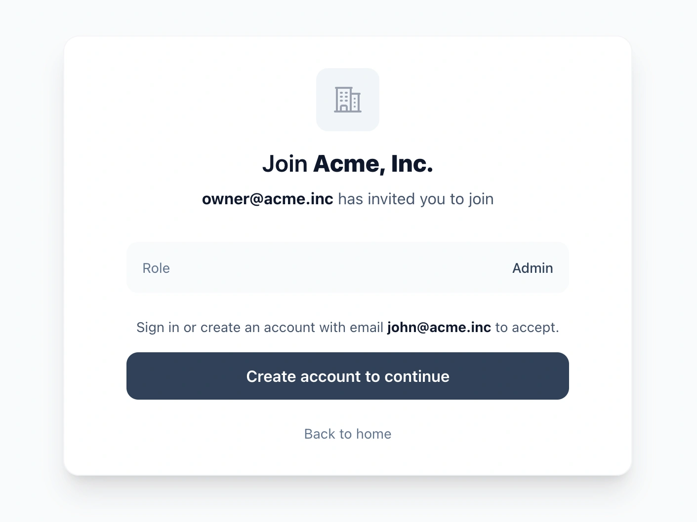
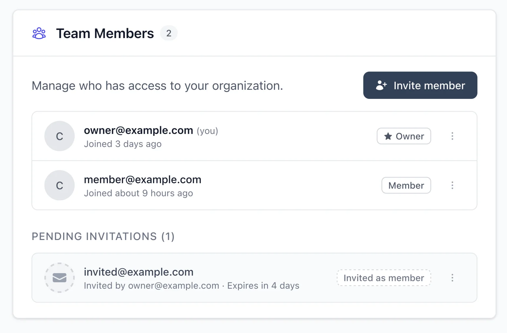
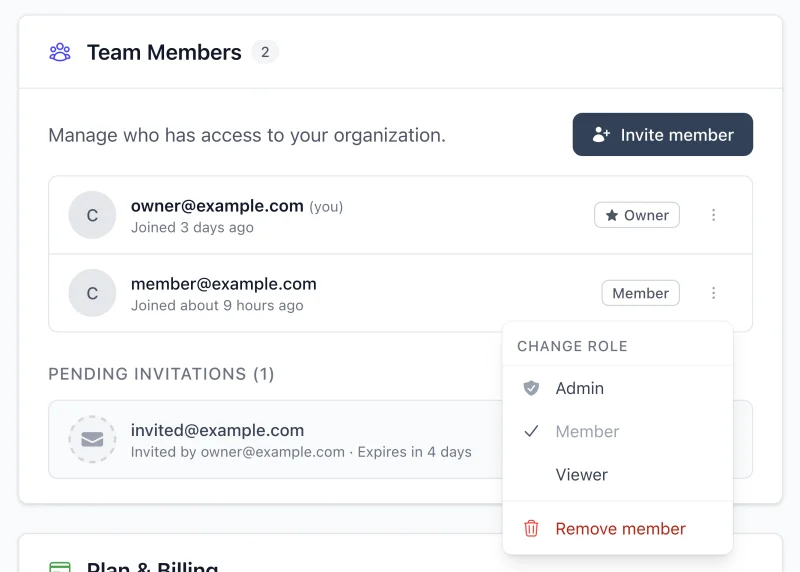
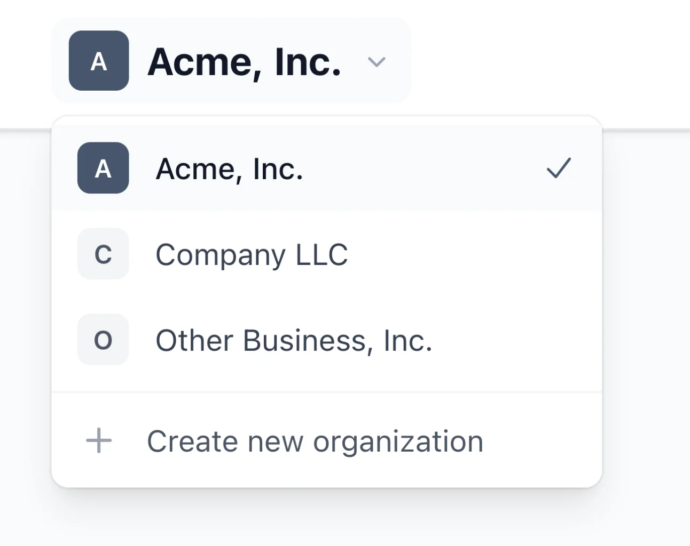

# 🏢 `organizations` – Add organizations with members and invitations to your Rails SaaS

[](https://badge.fury.io/rb/organizations) [](https://github.com/rameerez/organizations/actions)

> [!TIP]
> **🚀 Ship your next Rails app 10x faster!** I've built **[RailsFast](https://railsfast.com/?ref=organizations)**, a production-ready Rails boilerplate template that comes with everything you need to launch a software business in days, not weeks. Go [check it out](https://railsfast.com/?ref=organizations)!

`organizations` adds organizations with members to any Rails app. It handles team invites, user memberships, roles, and permissions.



**🎮 [Try the live demo →](https://organizations.rameerez.com)**

It's everything you need to turn a `User`-based app into a multi-tenant, `Organization`-based B2B SaaS (users belong in organizations, and organizations share resources and billing, etc.)

It's super easy:

```ruby
class User < ApplicationRecord
  has_organizations
end
```

That's it. Your users can now create organizations, invite teammates, and jump between accounts:

```ruby
current_user.create_organization!("Acme Corp")
current_user.send_organization_invite_to!("teammate@acme.com")
```

Then you could switch to the new org like this:

```ruby
switch_to_organization!(@org)
```

And check your roles / permissions in relation to that organization like this:

```ruby
current_user.is_organization_owner?     # => true
current_user.is_organization_admin?     # => true (owners inherit admin permissions)
```

https://github.com/user-attachments/assets/2eddafe2-025b-4670-af9f-e0d5480508c5

## Installation

Add to your Gemfile:

```ruby
gem "organizations"
```

> [!NOTE]
> For beautiful invitation emails, optionally add [`goodmail`](https://github.com/rameerez/goodmail).

Then:

```bash
bundle install
rails g organizations:install
rails db:migrate
rails g organizations:views   # copies the reference views (see BYO-UI note below)
```

Add `has_organizations` to your User model:

```ruby
class User < ApplicationRecord
  has_organizations
end
```

That's the simplest setup. You can also configure per-model options:

```ruby
class User < ApplicationRecord
  has_organizations do
    max_organizations 5         # Limit how many orgs a user can own (nil = unlimited)
    create_personal_org true    # Auto-create org on signup (default: false). Can also be a proc.
    require_organization true   # Require users to have at least one org (default: false)
  end
end
```

> **Note:** By default, users can exist without any organization (invite-to-join flow). Set `create_personal_org true` if you want to auto-create a personal organization when users sign up. For conditional creation, use a proc: `create_personal_org ->(user) { ... }` or override `should_create_personal_organization?` on your User model (see Pattern 4: Hybrid Onboarding).

Mount the engine in your routes:

```ruby
# config/routes.rb
mount Organizations::Engine => '/'
```

Don't want the whole engine UI? Declare which route groups to draw (devise_for-style) instead of shadowing routes:

```ruby
# config/initializers/organizations.rb
config.engine_routes = { except: [:organizations] }  # keep switching/memberships/invitations, no org CRUD
# or: config.engine_routes = { only: [:switching, :public_invitations] }
# Groups: :switching, :organizations, :memberships, :invitations, :public_invitations
```

> [!WARNING]
> Excluding a group also removes its **route helpers** — audit anything that references them: a custom `on_no_organization` handler calling `new_organization_path` raises `NameError` once `:organizations` is excluded (the default `redirect_path_when_no_organization = "/organizations/new"` would 404 too — point it somewhere real). The reference views also link across groups (the memberships page links to `organization_path`), so hosts that keep some engine pages while excluding others should retheme the copied views accordingly.

If your account model isn't named `User`:

```ruby
config.user_class = "Account"   # set BEFORE the models are first referenced (initializers are fine)
# The install migrations reference `to_table: :users` — adjust them to your user table.
```

Done. Your app now has full organizations / teams support.

> [!IMPORTANT]
> **Bring Your Own UI (BYOU):** This gem provides all the building blocks — models, controllers, routes, helpers, and mailers — but intentionally **does not ship with views**. Views are too context-dependent (Tailwind vs Bootstrap, dark mode, your app's design system) to be one-size-fits-all. Run `rails g organizations:views` to copy the Tailwind reference views into `app/views/organizations/` and retheme them — they're yours. The copies use the `heroicon` helper (add `gem "heroicons"`, or swap the icon calls for your own set), and the organization page's owner-only Danger Zone renders only if you provide `app/views/shared/_danger_zone.html.erb` (copy the full-featured one from the dummy). For the verified-joining screens, run `rails g organizations:join` (see "Generate the join and access screens"). For a complete working example, check out the demo app in [`test/dummy`](test/dummy/).

> [!NOTE]
> This gem uses the term "organization", but the concept is the same as "team", "workspace", or "account". It's essentially just an umbrella under which users / members are organized. This gem works for all those use cases, in the same way. Just use whichever term fits your product best in your UI.

## Quick start

### Create an organization

```ruby
org = current_user.create_organization!("Acme Corp")
# User automatically becomes the owner
```

### Invite teammates



```ruby
current_user.send_organization_invite_to!("teammate@example.com")
# Sends invitation email: "John invited you to join Acme Corp"
# When accepted, user joins as :member (default role)
```

The invitation goes from user to user. The organization is inferred from `current_organization`. You can also be explicit:

```ruby
current_user.send_organization_invite_to!("teammate@example.com", organization: other_org)
```

### Check roles and permissions



```ruby
# Quick role checks (in current organization)
current_user.is_organization_owner?   # => true/false
current_user.is_organization_admin?   # => true/false

# Permission checks
current_user.has_organization_permission_to?(:invite_members)
# "Does current user have organization permission to invite members?"

# Check role in a specific org
current_user.is_admin_of?(@org)
# "Is current user an admin of this org?"

current_user.is_member_of?(@org)
# "Is current user a member of this org?"
```

### Switch between organizations



```ruby
# User belongs to multiple organizations? No problem.
current_user.organizations        # => [acme, startup_co, personal]
switch_to_organization!(startup_co)  # Changes active org in session
```

### Protect controllers

```ruby
class ProjectsController < ApplicationController
  before_action :require_organization!
  before_action :require_organization_admin!, only: [:create, :destroy]
end
```

## Limit seats per plan (with `pricing_plans`)

> **Note:** This is an integration pattern, not built-in functionality. You implement the limit checks in your callbacks.

If you're using [`pricing_plans`](https://github.com/rameerez/pricing_plans), you can limit how many members an organization can have based on their effective pricing plan using callbacks:

```ruby
# config/initializers/pricing_plans.rb
plan :hobby do
  limits :organization_members, to: 3
end

plan :growth do
  limits :organization_members, to: 25
end
```

Then enforce the limit in **`on_member_joining` — the membership gate**. It runs strictly, inside the creating transaction, immediately before a membership row is inserted, on EVERY join path: `add_member!`, invitation acceptance, join-request approval (which covers join codes, email domains, allowlists, and the account-email shortcut). Raising vetoes the join and rolls back cleanly:

```ruby
# config/initializers/organizations.rb
Organizations.configure do |config|
  config.on_member_joining do |ctx|
    org = ctx.organization

    # The gate runs INSIDE the membership-creating transaction, so this row
    # lock serializes concurrent joins to the same org (and refreshes
    # member_count under the lock). Without it, two simultaneous joins can
    # both read "one seat left" and overshoot the cap by one — take the lock
    # when you sell hard seat counts; skip it for advisory/anti-abuse caps
    # where an off-by-one under a race is acceptable.
    org.lock!

    limit = org.current_pricing_plan.limit_for(:organization_members)

    if limit && org.member_count >= limit
      raise Organizations::MembershipVetoed, "Member limit reached. Please upgrade your plan."
    end
  end
end
```

> [!WARNING]
> **Do not enforce seat limits only in `on_member_invited`.** That hook guards the *invitation* path exclusively — the moment your app enables any verified-joining instrument (a join code, an email domain, an allowlist), invite-only enforcement is silently bypassable. `on_member_joining` is the one gate that covers every path. (Keeping an `on_member_invited` check *too* is nice UX — it rejects at invite time instead of accept time — but it's an optimization, not the enforcement.)

Details worth knowing:
- A vetoed join-request approval leaves the request **pending** (resumable — approve again after the upgrade); a vetoed invitation acceptance leaves the invitation pending too.
- A vetoed join-code redemption still **consumes a use**: uses are counted at redemption, before approval reaches the gate. `max_uses` is an anti-abuse cap, not a seat counter — seats live here, in the gate.
- The gate deliberately does NOT fire when an owner membership is created together with its organization (creating your own org is not "joining"), for idempotent already-a-member paths, or for role changes.
- `ctx` carries `organization`, `user`, `role`, `joined_via`, and the instrument (`invitation`/`join_request`) when one applies.
- Raising bare `Organizations::MembershipVetoed` uses a localized default message.

## Verified joining: let users prove they belong

Invitations cover org→user. Since v0.5.0 the gem also covers **user→org**: people who claim to belong to an organization and need to prove it. Four mechanisms, all converging on a regular `Membership` with provenance stamped on it:

| Mechanism | Proof | Typical use |
|---|---|---|
| Request-to-join | a human approves | small teams, communities |
| Email domain | 6-digit code emailed to `anything@yourdomain.com` | companies, universities |
| Join code ("PIN") | possession of the code (± domain email) | posters, newsletters, classrooms |
| Allowlist / roster | 6-digit code emailed to a rostered address | clubs with no own domain |

**The key idea: the proven email is decoupled from the account email.** A user signed up with a personal Gmail can still prove they control `j.doe@acme.com` and join Acme as a verified member. The proven address is recorded on the membership (`verified_email`) and is **unique per organization** — one inbox, one member.

```ruby
# ── Request-to-join (manual approval) ──────────────────────────────────────
request = user.request_to_join!(org, message: "I'm in the Madrid office")
org.pending_join_requests                      # approval queue
org.approve_join_request!(request, approved_by: admin)  # => Membership
org.reject_join_request!(request, rejected_by: admin, reason: "unknown")

# ── Email domain ───────────────────────────────────────────────────────────
org.add_domain!("acme.com")
request = user.request_to_join!(org)
request.start_email_verification!(email: "j.doe@acme.com")  # emails a 6-digit code
request.verify_email_code!("492817")           # => Membership (auto-approved)

# Zero-friction shortcut when the ACCOUNT email is already confirmed
# (e.g. Devise :confirmable) and its domain is enrolled:
org.join_with_account_email!(user)             # => Membership, no code needed

# ── Join code (PIN) ────────────────────────────────────────────────────────
code = org.generate_join_code!(label: "office poster", max_uses: 500,
                               expires_at: 3.months.from_now)
Organizations::JoinCode.redeem("7FHK-2MPX", user: user)  # => Membership
code.revoke!                                   # rotation = revoke + generate

# Reinforced mode: PIN + corporate email required (per-code!)
strict = org.generate_join_code!(requires_verified_domain_email: true)
request = Organizations::JoinCode.redeem(strict.code, user: user)  # => JoinRequest
request.start_email_verification!(email: "j.doe@acme.com")
request.verify_email_code!("492817")           # => Membership

# ── Allowlist / roster ─────────────────────────────────────────────────────
org.import_allowlist!(["ana@gmail.com", "luis@yahoo.es"], source: "csv_2026-07")
# Rostered users still complete the email challenge — a leaked roster grants
# nothing without inbox access. The entry is claimed on join.
```

### Domain authority: prove that the organization controls the domain

An emailed code proves that one person controls one inbox. It does not prove that the organization may claim the whole domain: a student with an `@university.edu` inbox is not the university. Before you let untrusted organizers enroll domains themselves, require a proof of control per organization and turn on `require_verified_domains`:

```ruby
config.require_verified_domains = true   # default: false (unverified domains work as before)
```

The proof is a DNS TXT record with an unpredictable token. The token belongs to one claim: one organization and one exact domain.

```ruby
domain = org.add_domain!("acme.com")
domain.start_verification!                 # new token; the challenge stays open 7 days
domain.verification_record_name            # => "_organizations-verification.acme.com"
domain.verification_record_value           # => "organizations-verification=Qm9…"
# The organization's admin publishes that TXT record, then:
domain.verify!                             # => domain
# On failure it raises Organizations::DomainVerificationFailed, and
# error.reason is :not_started, :expired, :changed, :record_not_found or :lookup_failed.
```

Or record an approval by a platform operator who checked the claim another way. A member of the claiming organization cannot approve its own claim (`NotAuthorized`); deciding who is platform staff is your app's job:

```ruby
domain.verify_by_operator!(operator: staff_user, note: "Registrar record checked, ticket 4411")
domain.verification_method   # => "operator"; domain.verified_by => staff_user
```

Later:

```ruby
domain.verified?                 # proven and not revoked
domain.revoke_verification!(reason: "domain sold")   # stops new domain-backed admissions; members stay
domain.recheck_verification!     # re-reads the TXT record and revokes when it is gone (schedule it if you like)
domain.start_verification!       # a new challenge: rotates the token and clears an earlier verification
Organizations::Domain.verified   # scope
```

The rules:

- **A verification does not expire on its own.** The 7-day TTL is for the open challenge only. Domains change hands: schedule `recheck_verification!` (for DNS proofs) or review operator approvals, and revoke what no longer holds.
- **Authority columns are privileged.** Only the methods above write `verified_at`, `verification_method`, `verified_by_id` and `verification_revoked_at`. Never let request params reach them: permit only `domain` and `join_policy` in your admin forms, and authorize who may call `verify!` and `verify_by_operator!`.
- **A proof belongs to one claim.** Moving a domain row to another organization, changing its domain, or copying it (`dup`) clears the proof. A revocation stays until a new proof succeeds, also after `start_verification!`.
- **Exact domains only.** No subdomain or suffix authority, and no global exclusivity: two departments can each prove their own claim of the same domain.
- **Changing `domain.domain` clears the verification and the token.** Start again.
- **Every domain path checks the same rule** (`Organizations::Domain.joinable`): the emailed challenge, the confirmed-account-email shortcut, domain-restricted join codes and `JoinFlow`. It checks again at admission: a domain (or allowlist entry) removed, revoked or blocked while a code was in flight admits nobody. An admin can still approve such a pending request by hand.
- **A revoked domain never admits**, also with `require_verified_domains` off. Existing members stay.
- **Existing domains start unverified.** Nothing is grandfathered. Verify them before you turn on `require_verified_domains`.
- **Invitations, plain codes and allowlists stay separate grants.** They do not depend on domain authority.
- Rate-limit the endpoint that calls `verify!`, and tell joiners which organization will see their address before they submit it.

Configuration:

```ruby
config.domain_verification_record_prefix = "_myapp-verification"   # your brand in the DNS label
config.domain_verification_ttl = 7.days        # how long a challenge stays open
config.domain_verification_timeout = 5         # seconds for the built-in Resolv lookup
config.domain_txt_resolver = ->(name) { MyDns.txt(name) }           # custom lookup, returns [String]
```

**Blocking public email providers (opt-in).** A preset ships with the gem:

```ruby
config.blocked_email_domains = Organizations::PUBLIC_EMAIL_DOMAINS   # default: []
```

A blocked domain cannot be enrolled, and an existing row for it stops admitting. People with those addresses can still join by invitation, code or allowlist. The list is defence in depth, not proof of authority and not an authorization boundary: an unlisted provider is not trusted because it is unlisted.

### Sign-up domain policies: none, suggest, auto-join

Each domain has a `join_policy` for people who sign up with a confirmed account email at that domain. The policy acts only while the domain is verified, and only when the account email is confirmed (Devise `:confirmable` or similar) and `trust_confirmed_account_email` is on:

| `join_policy` | What happens |
|---|---|
| `"none"` (default) | Nothing. The explicit join flows work as before. |
| `"suggest"` | The organization appears in `user.suggested_organizations`. The user still chooses to join. |
| `"auto_join"` | The user joins after sign-up, or right after confirming the email, through the membership gate (`on_member_joining` can veto). |

```ruby
org.add_domain!("acme.com", join_policy: :suggest)
domain.update!(join_policy: :auto_join)
domain.effective_join_policy           # => :none until the domain is verified

current_user.suggested_organizations   # verified "suggest" or "auto_join" domains, minus orgs they are in
org.join_with_account_email!(current_user)   # the "Join" button for a suggestion
current_user.join_organizations_by_domain!   # what auto-join runs; idempotent, returns memberships
```

Auto-join runs in an `after_commit` on the user when `confirmed_at` changes, and never breaks a sign-up: a veto or an already-claimed email skips that organization and logs it. Changing the email of an account that stays confirmed does not trigger it, because nothing proved the new address. The trigger reads the changes of the last save in the transaction, so set `confirmed_at` in that save (Devise does). With Devise `:reconfirmable`, confirming the new address updates `confirmed_at` and triggers it.

### Cohorts without the gem knowing (`membership_metadata`)

Every join instrument (domain, code, allowlist entry, invitation) carries a `membership_metadata` hash that's merged onto memberships it creates. The gem never interprets it — it's your cohort/segmentation channel:

```ruby
org.add_domain!("acme.com",          membership_metadata: { member_kind: "employee" })
org.add_domain!("students.acme.edu", membership_metadata: { member_kind: "student" })
# later…
membership.metadata["member_kind"]  # => "student"
membership.joined_via               # => "domain_email"
membership.verified_email           # => "x@students.acme.edu"
membership.verified?                # => true
```

### Building the join UI: `JoinFlow` + `JoinState`

The models above are the exception-raising programmatic layer. For controllers and views, use the headless join kit — one call in, one state out, no rescue ladders:

```ruby
# The controller: every join input goes through ONE facade
result = Organizations::JoinFlow.attempt(
  user: current_user, organization: @org,
  code: params[:code],                        # a join code (PIN), if typed
  email: params[:email],                      # start the emailed challenge
  verification_code: params[:verification_code],  # the typed 6-digit code
  message: params[:message]                   # note for manual approval
)
result.outcome     # :member | :challenge_sent | :pending | :vetoed | :error
result.reason      # stable symbol from JoinFlow::REASONS (map your copy off this)
result.message     # localized human message (rides the i18n catalog)
result.membership / result.join_request

# The view: one object decides which screen state renders
@state = Organizations::JoinState.for(user: current_user, organization: @org, result: result)
@state.status          # :member | :verifying | :pending | :entry
@state.resend_seconds  # cooldown for the "resend code" button, derived from config
@state.error_message   # localized message of a just-failed action
@state.member? / verifying? / pending? / entry?   # the same states as predicates
@state.challenge       # the join request whose emailed code is in flight

# Which entry forms to show — the org's actual instruments decide:
org.accepts_domain_joining?  # email form (domains or unclaimed allowlist entries)
org.accepts_code_joining?    # code form (at least one actually-redeemable code)
org.accepts_join_requests?   # anything at all
```

### Generate the join and access screens

```bash
rails g organizations:join                 # join screen + access screen + routes
rails g organizations:join --skip-access   # the join screen only
rails g organizations:join --skip-routes   # add the routes yourself
```

The generator copies host-owned controllers and views (Tailwind, like `organizations:views`) and adds one routes block. Run it again later without `--skip-access` and it adds only the access routes. The engine itself adds no join route, so nothing changes in your app until you run it.

| Screen | URL | What it does |
|---|---|---|
| `OrganizationJoinsController` | `GET/POST/DELETE /orgs/:organization_id/join` (`organization_join_path`) | The four `JoinState` states at one URL: a code, a work email and its 6-digit code, or a plain request; withdraw a pending request |
| `OrganizationAccessController` | `/orgs/:organization_id/access` (`organization_access_path`) | Pending requests (approve, reject), email domains (DNS verification, sign-up policy), join codes (create, revoke), the allowlist (import, remove) |

The generated code already follows the safety rules. Keep them when you edit it:

- **A signed-in user is required** (`config.authenticate_user_method`). The join screen takes the organization from the URL and never changes the session's current organization.
- **Only POST and DELETE change data**, under Rails' CSRF protection. A `?code=…` link fills in the form; it never joins and never spends a use, also after a sign-in redirect.
- **Inputs are cut to a fixed length**, and allowlist imports to 1,000 addresses; invalid addresses are skipped and counted.
- **Unknown, revoked, expired and foreign codes share one message** (`JoinFlow` does that).
- **The access screen is URL-scoped** with `OrganizationScoped`: it needs `invite_members`, domain changes also need `manage_settings`, and every lookup is scoped to the URL's organization. Unknown organizations, strangers and members without the permission all get the same 404.
- **Rate limits** on joining, on the screen, and on DNS checks. They need Rails 7.2+ and a cache store that every server process shares (Redis, Solid Cache): the null and memory stores do not enforce them across processes. On Rails 7.1, use Rack::Attack.
- **A sent code or a pending request redirects** (303), as Turbo expects. Failures render with 422.
- **The signed-in user comes from `config.current_user_method`**, the same as the rest of the gem.
- **A disclosure partial** (`organization_joins/_disclosure.html.erb`) tells joiners who will see their name and email before they submit. Edit its text to match your privacy policy.

The templates are the gem's demo app ([`test/dummy`](test/dummy/)), byte for byte, and its HTTP test suite covers them. Two things to know: the join screen shows an organization's name to any signed-in user who has its id (use UUID primary keys or a handle finder for private tenants), and the generator does not check for controllers with the same names in your app (Thor asks before it overwrites a file). When your `routes.rb` has no `routes.draw do` line to insert after, the generator prints the routes for you to add.

### Rate limiting your join endpoints

The engine adds no join routes, so the rate limits live in your controllers — and **code redemption and code verification are enumeration surfaces**. `rails g organizations:join` adds these limits; for your own controllers, use Rails' built-in [`rate_limit`](https://api.rubyonrails.org/classes/ActionController/RateLimiting.html):

```ruby
class OrganizationJoinsController < ApplicationController
  # Joining/redeeming: per-user, generous but bounded
  rate_limit to: 10, within: 1.hour, by: -> { current_user.id }, only: :create
  # Public landings (if any are unauthenticated): per-IP against slug/code enumeration
  # rate_limit to: 60, within: 1.minute, by: -> { request.remote_ip }, only: :show
end
```

Layer them per surface: the gem already throttles **per request** (60s resend interval, 5 sends, 5 attempts per challenge); your controller limits cap **per user/IP across requests** — mail-bombing and brute-force across fresh challenges. And keep the generic error copy for unknown codes: `JoinFlow` already collapses unknown/revoked/expired/foreign codes into one reason — don't "improve" it into an oracle. (One narrow residual the rate limits also cover: an expired org-scoped code does slightly more work than the fast-reject paths before raising - identical response shape, but a measurable timing side-channel without endpoint limits.)

### Security posture

- Codes are stored as **SHA-256 digests only** (peppered by row id), compared in constant time, single-use, expire after `verification_code_ttl` (15 min default), capped at `verification_max_attempts` (5) with resend throttles.
- Emails are normalized before the uniqueness check (case, whitespace, and `+tag` plus-addressing collapse — override via `config.verification_email_normalizer`).
- An emailed code proves one inbox, never the whole domain. Domain authority (DNS TXT or operator approval) is a separate proof per organization; turn on `require_verified_domains` before untrusted self-service enrollment (see "Domain authority").
- Domain matching is **exact** and evasion-hardened: `acme.com.evil.com`, `evilacme.com`, multi-`@` shapes never match; subdomains are separate domains on purpose (they often mean different cohorts).
- BYO-UI as always: the gem ships models/APIs/mailers and state; **you must rate-limit your join/redemption/verification endpoints** (see above).
- Hard member caps belong in **`on_member_joining`** (the strict membership gate) — the `on_join_request_*` after-callbacks are error-isolated and cannot veto. Take `ctx.organization.lock!` inside the gate when the cap must hold under concurrent joins (see "Limit seats per plan").
- **`max_uses` is an anti-abuse cap, not a seat counter**: join-code uses are counted at redemption, so a redemption later vetoed by the gate still consumed a use.
- One deliberate exception to the one-generic-reason rule: an **exhausted** code surfaces its own reason (`:join_code_exhausted`), so legitimate holders learn the code ran out instead of retyping it forever. This confirms such a code exists — if that trade-off bothers you, render it with the same copy as `:join_code_invalid`.
- Verification-email delivery failures are handled: the gem rolls the throttle bookkeeping back (immediate retry, the failed send doesn't count) and fires `on_verification_delivery_failed` — wire it to your error tracker so mail outages are visible:

```ruby
config.on_verification_delivery_failed do |ctx|
  Rails.error.report(RuntimeError.new("Verification email failed: #{ctx.metadata["error_message"]}"),
                     context: { join_request_id: ctx.join_request.id })
end
```

Upgrading an existing install: `rails g organizations:upgrade && rails db:migrate` (additive only). The generator adds only the migrations your app does not have yet (it asks the database when it can, and reads `db/migrate` otherwise), so run it after every upgrade of the gem. For a squashed migration history, name the steps: `rails g organizations:upgrade --steps add_personal_organizations`.

## Why this gem exists


Organizations / teams are tough to do alone. Wiring up accounts, roles, and invites by hand is a pain you only want to go through once. If you don't implement organizations / teams on day one, adding them later becomes a major refactor — the kind that touches every model, controller, and permission in your app. Even experienced Rails developers have built accounts / teams poorly multiple times before getting it right.

No more asking yourself "should I just roll my own?" No more stitching together `acts_as_tenant` + `rolify` + `devise_invitable` + `pundit` and writing 500 lines of glue code. No more paying $250/year for a boilerplate template just because it has organizations / teams built in. The `organizations` gem gives you everything in a single `bundle add`.

Every B2B Rails app eventually needs organizations / teams. Yet there's no standalone gem that allows you to just flip a switch and add organizations to your app.

| What you need | What exists today |
|---------------|-------------------|
| Organization model | ✅ Easy, just scaffold it |
| Membership (User ↔ Organization join table) | ❌ Write it yourself |
| Invite users to a *specific* organization | ❌ `devise_invitable` invites to the *app*, not to an org |
| Roles scoped to each organization | ❌ `rolify` stores roles globally, not per-org |
| Let users jump between organizations | ❌ Write it yourself |
| **All of the above, integrated** | ❌ **Pay $250+ for a boilerplate** |

The day will come when you need to associate your users in organizations — and it will be the refactor from your worst nightmares. Rails does not make your life easy when you want to work this way, with multiple tenants. The typical Rails developer stitches together `acts_as_tenant` + `rolify` + `devise_invitable` + `pundit` and writes 500-1,000 lines of glue code that feels brittle compared to the usual simplicity of Rails. That takes 1-2 months. Some developers have estimated 200+ hours of work. Or you pay $250+/year for a boilerplate template where organizations / teams is the headline feature.

Laravel has Jetstream with a `--teams` flag. Django has `django-organizations`. Rails has had nothing — until now.

| Framework | Organizations / Teams Solution | Cost |
|-----------|-------------------------------|------|
| Laravel | Jetstream `--teams` | Free |
| Django | django-organizations | Free |
| Rails | `organizations` gem | Free |

`organizations` gives you the complete `User → Membership → Organization` pattern with scoped invitations, hierarchical roles, and the ability to switch between organizations – all in a single, well-tested gem that works with your existing Devise setup. What previously took 1.5 months now takes 3 days.

> [!NOTE]
> This gem handles organization membership and org-level permissions (who can invite members, who can manage billing), plus optional per-record grants for members who should see only some records (see "Scoped resource grants"). For general per-record policies ("users can edit their own posts"), use [Pundit](https://github.com/varvet/pundit) or [CanCanCan](https://github.com/CanCanCommunity/cancancan) alongside this gem.

## The complete API

### User methods

When you add `has_organizations` to your User model, you get:

```ruby
# Associations
user.organizations                      # All organizations user belongs to
user.memberships                        # All memberships (with roles)
user.owned_organizations                # Organizations where user is owner
user.personal_organization              # Their personal organization, or nil (never creates one)
user.pending_organization_invitations   # Invitations waiting to be accepted

# Current organization context
user.organization                       # Alias for current_organization (most common use)
user.current_organization               # Active org for this session
user.current_membership                 # Membership in active org
user.current_organization_role          # Role in current org => :admin

# Quick boolean checks
user.belongs_to_any_organization?           # "Does user belong to any org?"
user.has_pending_organization_invitations?  # "Does user have pending invites?"

# Permission checks (in current organization)
user.has_organization_permission_to?(:invite_members)   # => true/false
user.has_organization_role?(:admin)                     # => true/false

# Role shortcuts (in current organization)
user.is_organization_owner?             # Same as has_organization_role?(:owner)
user.is_organization_admin?             # Same as has_organization_role?(:admin)
user.is_organization_member?            # Same as has_organization_role?(:member)
user.is_organization_viewer?            # Same as has_organization_role?(:viewer)

# Role checks (explicit organization)
user.is_owner_of?(org)                  # "Is user an owner of this org?"
user.is_admin_of?(org)                  # "Is user an admin of this org?"
user.is_member_of?(org)                 # "Is user a member of this org?"
user.is_viewer_of?(org)                 # "Is user a viewer of this org?"
user.is_at_least?(:admin, in: org)      # "Is user at least an admin in this org?"
user.role_in(org)                       # => :admin

# Domain policies (see "Sign-up domain policies")
user.suggested_organizations            # Organizations to offer, from verified domains
user.join_organizations_by_domain!      # Join every verified auto_join domain (runs on its own)

# Actions
user.create_organization!("Acme")            # Positional arg
user.create_organization!(name: "Acme")      # Keyword arg (both work)
user.leave_organization!(org)
user.leave_current_organization!             # Leave the active org
user.send_organization_invite_to!(email)                     # Invite to current org
user.send_organization_invite_to!(email, organization: org)  # Invite to specific org
user.create_personal_organization!           # Create it, or return the existing one

# Account deletion
user.account_deletion_plan                   # What user.destroy would do (changes nothing)
Organizations::AccountDeletionPlan.for(user, lock: true)  # The same plan under the guard's locks
```

### Organization methods

```ruby
# Associations
org.memberships                 # All memberships
org.members                     # All users (alias for org.users)
org.users                       # All users (through memberships)
org.invitations                 # All invitations (pending + accepted)
org.pending_invitations         # Invitations not yet accepted

# Queries
org.owner                       # User who owns this org
org.owner_membership            # The owner's Membership
org.admins                      # Users with admin role or higher
org.has_member?(user)           # "Does org have this user as a member?"
org.has_any_members?            # "Does org have any members?"
org.member_count                # Number of members

# Class methods / Scopes
Organizations::Organization.with_member(user)  # Find all orgs where user is a member
Organizations::Organization.personal           # Personal organizations
Organizations::Organization.not_personal       # Every other organization
Organizations::Organization.backfill_personal_owners!(mapping, dry_run: true)

# Personal organizations
org.personal?                   # "Is this someone's personal organization?"
org.personal_owner              # The user it belongs to
org.convert_to_shared!          # Stop being personal

# Actions
# Pass the acting user (removed_by:, changed_by:) so the role rule is checked;
# without one, or with a user who is not a member, nothing is checked.
org.add_member!(user, role: :member)            # no actor: never checked, authorize it yourself
org.remove_member!(user, removed_by: current_user)
org.change_role_of!(user, to: :admin, changed_by: current_user)
org.transfer_ownership_to!(other_user)
org.transfer_ownership_to!(other_user, convert_to_shared: true)  # Hand over a personal org: it becomes shared

# Invitations (inviter must be a member with :invite_members permission)
org.send_invite_to!(email)                  # Auto-infers invited_by from Current.user
org.send_invite_to!(email, invited_by: user) # Explicit inviter
org.send_invite_to!(email, invited_by: user, grants: { record => %i[read] })  # With scoped grants
org.grants                                  # Every grant of every membership

# Scopes
org.memberships.owners          # Memberships with owner role
org.memberships.admins          # Memberships with admin role
org.invitations.pending         # Not yet accepted
org.invitations.expired         # Past expiration date

# Creation (ops/provisioning primitive: no session switching, no per-user
# cap, fires on_organization_created — for consoles, seeds, admin panels)
Organizations::Organization.create_with_owner!(owner: admin, name: "Acme Corp")

# Verified joining
org.domains / org.join_codes / org.allowlist_entries / org.join_requests
org.add_domain!("acme.com", membership_metadata: {}, join_policy: :none)
org.generate_join_code!(label:, requires_verified_domain_email:, auto_approve:, expires_at:, max_uses:)
org.import_allowlist!(emails, source:, membership_metadata: {})
org.approve_join_request!(req, approved_by:) / org.reject_join_request!(req, rejected_by:, reason:)
org.join_with_account_email!(user)
org.accepts_domain_joining?     # email form? (domains or unclaimed roster entries)
org.accepts_code_joining?       # code form? (at least one actually-redeemable code)
org.accepts_join_requests?      # any self-serve mechanism at all
org.join_codes.active           # SQL twin of code.active?

# The join kit (controller/view layer — see "Verified joining")
Organizations::JoinFlow.attempt(user:, organization:, code:, email:, verification_code:, message:)
Organizations::JoinState.for(user:, organization:, result:)
# rails g organizations:join  → OrganizationJoinsController + OrganizationAccessController + routes

# Domain authority (see "Domain authority")
domain.start_verification! / domain.verify! / domain.verify_by_operator!(operator:, note:)
domain.verification_record_name / domain.verification_record_value
domain.verified? / domain.revoked? / domain.joinable? / domain.effective_join_policy
domain.revoke_verification!(reason:) / domain.recheck_verification!
Organizations::Domain.verified / Organizations::Domain.joinable / Organizations::Domain.with_join_policy(:suggest)

# Housekeeping
Organizations::JoinRequest.purge_stale!(older_than: 12.months)  # GDPR sweep: old decided/expired requests

# Typed boolean toggles over the metadata bag (also on Membership)
Organizations::Organization.metadata_flag :beta_features, default: false
```

### Membership methods

```ruby
membership.role                 # => "admin"
membership.organization         # The organization
membership.user                 # The user
membership.invited_by           # User who invited them (if any)

# Permission checks
membership.has_permission_to?(:invite_members)   # => true/false
membership.permissions                           # => [:view_members, :invite_members, ...]
membership.role_sym                              # => :admin
membership.owner? / admin? / member? / viewer?   # Exact role
membership.verified?                             # Joined with a proven email (verified joining)

# Role hierarchy checks
membership.is_at_least?(:member)    # => true (if member, admin, or owner)
membership.can_assign_role?(:admin) # => true (if admin or owner: roles at or below their own)
membership.compare_role(other)      # => -1 (higher), 0, 1 (lower)
membership.authorize_role_change!(:admin, changed_by: current_user)  # Raises NotAuthorized when a member actor outranks or lacks the roles' permissions (does not check :edit_member_roles; nil or non-member actors pass: authorize them yourself)

# Role changes
membership.promote_to!(:admin, changed_by: current_user)  # Change role to admin
membership.demote_to!(:member, changed_by: current_user)  # Change role to member

# Scoped resource grants (see "Scoped resource grants")
membership.grants                                         # Its grants
membership.grant!(record, capabilities: %i[read], granted_by: current_user)
membership.revoke_grant!(record, revoked_by: current_user)
membership.can?(:read, record) / membership.capabilities_for(record)
membership.granted?(record) / membership.grant_for(record)
membership.limited_by_grants?                             # Role below config.full_resource_access_role
membership.visible(relation, capability: nil) / membership.granted_ids(Model, capability: nil)
Organizations::Membership.with_grant_on(record)           # Memberships granted this record
```

### Invitation methods

```ruby
invitation.email                # => "teammate@example.com"
invitation.organization         # The organization
invitation.role                 # Role they'll have when accepted
invitation.invited_by           # User who sent the invitation
invitation.from                 # Alias for invited_by
invitation.pending?             # => true (not yet accepted)
invitation.accepted?            # => true (has accepted_at)
invitation.expired?             # => true (past expires_at)
invitation.status               # => :pending, :accepted or :expired
invitation.for_email?(email)    # Case-insensitive match
invitation.acceptance_url       # Link for your own mailer (honors the engine mount path)
invitation.acceptance_url(base_url: "https://app.example.com")   # In jobs/mailers without URL defaults

# Grants the membership gets on acceptance
invitation.grants
invitation.grant!(record, capabilities: %i[read])

# Actions
invitation.accept!              # Accept (auto-infers Current.user)
invitation.accept!(user)        # Accept with explicit user
invitation.resend!(resent_by: current_user)   # Send invitation email again
invitation.revoke!(revoked_by: current_user)  # Delete it, so the link stops working
```

### Verified-joining records

```ruby
# Organizations::JoinRequest
request.pending? / approved? / rejected? / withdrawn? / expired? / decided?
request.effective_status            # => :pending, :approved, :rejected, :withdrawn or :expired
request.email_verified?
request.start_email_verification!(email: "j.doe@acme.com")
request.verify_email_code!("492817")   # => Membership (or the request, when approval is manual)
request.approve!(decided_by: admin)    # => Membership. Records the actor; checking that it may decide is your job
request.reject!(rejected_by: admin, reason: "unknown")
request.withdraw!                      # The user cancels it. Check that the caller owns the request
user.pending_join_request_for(org)     # The user's open request, or nil

# Organizations::JoinCode
code.code / code.display_code          # "7FHK2MPX" / "7FHK-2MPX"
code.active? / revoked? / expired? / exhausted? / code.status
code.redeem!(user: user)               # Same as JoinCode.redeem(code.code, user:)
code.revoke!

# Organizations::Domain
domain.matches_email?("j.doe@acme.com")   # Exact domain match
domain.blocked?                           # Listed in config.blocked_email_domains
domain.verification_expired?              # The open DNS challenge passed its TTL
# (verification methods: see "Domain authority")

# Organizations::AllowlistEntry
entry.claimed? / entry.claim!(user)

# Organizations::Grant (see "Scoped resource grants")
grant.capabilities / grant.allows?(:read) / grant.resource / grant.grantable
# grant.allows? reads the stored list only. To authorize, ask membership.can?(capability, record):
# it also applies the role ceiling and the organization check.
```

### Roles

```ruby
Organizations::Roles.hierarchy                  # => [:owner, :admin, :member, :viewer] (custom roles included)
Organizations::Roles.valid_role?(:admin)        # => true
Organizations::Roles.permissions_for(:member)   # => [:view_organization, ...]
Organizations::Roles.has_permission?(:admin, :invite_members)  # => true
Organizations::Roles.at_least?(:owner, :admin)  # => true
Organizations::Roles.compare(:admin, :member)   # => -1 (higher), 0, 1 (lower)
Organizations::Roles.higher_role(:member) / lower_role(:member)  # => :admin / :viewer
Organizations::Roles.can_assign?(:admin, :member)                # the role rule (see "Customize roles")
Organizations::Roles.assignment_refusal(:member, :admin)         # => :outranks, :lacks_permissions or nil
```

### User housekeeping

```ruby
user.clear_organization_cache!   # Forget the memoized current organization and membership
```

## Controller helpers

Include the controller concern in your ApplicationController:

```ruby
class ApplicationController < ActionController::Base
  include Organizations::Controller
end
```

This gives you:

```ruby
# Context helpers
current_organization            # Active organization (from session)
current_membership              # Current user's membership in active org
organization_signed_in?         # Is there an active organization?

# Pending invitation helpers
pending_organization_invitation_token   # Get pending invitation token from session
pending_organization_invitation         # Get pending invitation (clears if expired)
pending_organization_invitation?        # Check if valid pending invitation exists
pending_organization_invitation_email   # Get invited email (for signup prefill)
clear_pending_organization_invitation!  # Clear invitation token and cache

# Invitation acceptance (canonical helper for post-signup flows)
accept_pending_organization_invitation!(user)                    # Accept with session token
accept_pending_organization_invitation!(user, token: token)      # Explicit token
accept_pending_organization_invitation!(user, switch: false)     # Don't auto-switch org
accept_pending_organization_invitation!(user, return_failure: true) # Returns failure object on rejection
pending_invitation_acceptance_redirect_path_for(user)            # Accept + resolve redirect path
handle_pending_invitation_acceptance_for(user, redirect: true)   # Accept + optionally redirect
# Returns InvitationAcceptanceResult or nil

# Invitation redirect helpers
redirect_path_when_invitation_requires_authentication(invitation)  # Get auth redirect
redirect_path_after_invitation_accepted(invitation, user: user)    # Get post-accept redirect
redirect_path_after_organization_switched(org, user: user)         # Get post-switch redirect

# No-organization helpers
redirect_path_when_no_organization(user: nil)                     # Resolve configured no-org redirect path
no_organization_redirect_path                                     # Alias
redirect_to_no_organization!(alert: "...", notice: "...")         # Redirect and return false

# Organization creation helper
create_organization_and_switch!(current_user, name: "Acme")       # Create and set context in one call
create_organization_with_context!(current_user, name: "Acme")     # Backward-compatible alias
self.current_organization = org                                  # Set the session's organization (no membership check; prefer switch_to_organization!)

# Authorization
require_organization!                               # Redirect if no active org
require_organization_role!(:admin)                  # Require at least admin role
require_organization_permission_to!(:invite_members) # Require specific permission

# Authorization shortcuts (for common roles)
require_organization_owner!     # Same as require_organization_role!(:owner)
require_organization_admin!     # Same as require_organization_role!(:admin)

# Switching
switch_to_organization!(org)              # Change active org in session
switch_to_organization!(org, user: user)  # Explicit user (for auth-transition flows)
```

### Protecting resources

```ruby
class SettingsController < ApplicationController
  before_action :require_organization!
  before_action :require_organization_admin!  # Shortcut for require_organization_role!(:admin)

  def billing
    require_organization_owner!  # Only owners can manage billing
  end
end
```

`manage_billing` and `view_billing` are authorization checks only. They control who in the organization can access your billing UI, but they do not imply an active Stripe subscription or determine the effective pricing plan.

### Handling unauthorized access

Configure how unauthorized access is handled:

```ruby
# config/initializers/organizations.rb
Organizations.configure do |config|
  config.on_unauthorized do |context|
    # context.user, context.organization, context.permission, context.required_role
    redirect_to root_path, alert: "You don't have permission to do that."
  end

  config.on_no_organization do |context|
    redirect_to new_organization_path, alert: "Please create or join an organization first."
  end
end
```

## View helpers

Include in your ApplicationHelper:

```ruby
module ApplicationHelper
  include Organizations::ViewHelpers
end
```

### Permission checks in views

```ruby
<% if current_user.has_organization_permission_to?(:invite_members) %>
  <%= link_to "Invite teammate", new_invitation_path %>
<% end %>

<% if current_user.is_organization_admin? %>
  <%= link_to "Settings", organization_settings_path %>
<% end %>
```

### Organization switcher

Build your own switcher UI with the helper:

```ruby
<% data = organization_switcher_data %>

<div class="org-switcher">
  <button><%= data[:current][:name] %></button>
  <ul>
    <% data[:others].each do |org| %>
      <li>
        <%= link_to org[:name], data[:switch_path].call(org[:id]) %>
      </li>
    <% end %>
  </ul>
</div>
```

The helper returns:

```ruby
{
  current: { id: "...", name: "Acme Corp" },
  others: [
    { id: "...", name: "Personal" },
    { id: "...", name: "StartupCo" }
  ],
  switch_path: ->(org_id) { "/organizations/switch/#{org_id}" }
}
```

### All view helpers

```ruby
organization_switcher_data                          # See "Organization switcher"
organization_invitation_badge(user)                 # See "Invitation badge"

organization_role_label(:admin, organization: org)  # => "Admin" (I18n; the organization selects its vocabulary)
organization_role_info(:admin, organization: org)   # => { role: :admin, label: "Admin", color: :blue }
organization_invitation_status(invitation)          # => :pending, :accepted or :expired
organization_invitation_status_label(invitation)    # => "Pending"
organization_invitation_status_info(invitation)     # => { status:, label:, color: }
organization_members_data(org)                      # => [{ id:, membership_id:, name:, email:, role:, role_label:, role_info:, joined_at:, is_owner: }]
organization_invitations_data(org)                  # => [{ id:, email:, role:, role_label:, invited_by:, invited_by_name:, status:, status_info:, expires_at:, created_at: }]

can_manage_organization?(user, org)     # manage_settings
can_invite_members?(user, org)          # invite_members
can_view_billing?(user, org)            # view_billing
can_manage_billing?(user, org)          # manage_billing
can_remove_member?(user, membership)    # remove_members, and the role rule
can_change_member_role?(user, membership)  # edit_member_roles, and the role rule
can_transfer_ownership?(user, org)      # transfer_ownership
can_delete_organization?(user, org)     # delete_organization
```

Inside engine views, the host app's route helpers work without `main_app.` (the engine delegates unknown `*_path` and `*_url` helpers to the host).

### Invitation badge

```ruby
# Show pending invitation count in your navbar
<%= organization_invitation_badge(current_user) %>
# => <span class="badge">3</span> (if 3 pending invitations)
# => nil (if no pending invitations)
```

## Roles and permissions

### Organization permissions vs. resource authorization

`organizations` handles **org-level permissions** — what a user can do *within an organization*:

```ruby
current_user.has_organization_permission_to?(:invite_members)
# "Can they invite people to this org?"

current_user.has_organization_permission_to?(:manage_billing)
# "Can they manage this org's billing?"

require_organization_permission_to!(:manage_settings)
# Gate org settings pages
```

This is different from **resource authorization** (Pundit, CanCanCan) — what a user can do *to a specific record*:

```ruby
# Pundit/CanCanCan territory (not what this gem does)
policy(@document).update?      # "Can they edit THIS specific document?"
authorize! :destroy, @project  # "Can they delete THIS specific project?"
```

| | `organizations` gem | Pundit / CanCanCan |
|---|---------------------|-------------------|
| **Question** | "What can this user do in this org?" | "Can this user do X to record Y?" |
| **Scope** | Organization-wide capabilities | Per-record authorization |
| **Based on** | Role in Membership | Policy classes / Ability rules |
| **Example** | "Admins can invite members" | "Users can edit their own posts" |

**Most B2B apps need both.** Use `organizations` for org membership and capabilities. Use Pundit/CanCanCan for fine-grained resource authorization. They're complementary, not competing. Between the two sits one common case the gem covers: **some members see only some records** (an accountant who handles three of a firm's clients, a contractor on one project). See "Scoped resource grants".

### Scoped resource grants

A grant gives one membership access to one record of your app, with a list of capabilities. Members whose role ranks below `config.full_resource_access_role` (`:admin` by default) see only the records granted to them. Admins and the owner see everything through their role. **The role stays the ceiling:** a member can use a granted capability only when the role also has it as a permission. A grant narrows; it never widens.

It is optional. Add the table, then mark the models you grant:

```bash
rails g organizations:grants   # check the type of grantable_id, then:
rails db:migrate
```

Capabilities are checked against the role's permissions, so give your roles the capabilities they may use on granted records (custom roles work too):

```ruby
# A block that redefines a built-in role defines only the built-in roles it
# lists, so list all four: these are the defaults plus the capabilities.
config.roles do
  role :viewer do
    can :view_organization
    can :view_members
    can :read
  end
  role :client, inherits: :viewer do   # a narrow custom role
    can :comment
  end
  role :member, inherits: :viewer do
    can :create_resources
    can :edit_own_resources
    can :delete_own_resources
    can :comment
    can :edit
  end
  role :admin, inherits: :member do
    can :invite_members
    can :remove_members
    can :edit_member_roles
    can :manage_settings
    can :view_billing
  end
  role :owner, inherits: :admin do
    can :manage_billing
    can :transfer_ownership
    can :delete_organization
  end
end
```

```ruby
class Project < ApplicationRecord
  include Organizations::Grantable   # project.organization_grants, Project.visible_to(membership)
end
```

```ruby
membership = org.memberships.find_by!(user: contractor)

membership.grant!(project, capabilities: %i[read edit], granted_by: current_user)
membership.grant!(project, capabilities: %i[read])      # again: replaces the capabilities
membership.grant!(project, capabilities: [])            # no capabilities: removes the grant
membership.revoke_grant!(project, revoked_by: current_user)

membership.can?(:edit, project)        # grant lists it AND the role has the :edit permission
membership.capabilities_for(project)   # => #<Set: {:read}>
membership.granted?(project)
membership.grant_for(project)          # => #<Organizations::Grant capabilities: ["read"]>
membership.limited_by_grants?          # => true for a member, false for an admin

Project.visible_to(membership)                     # what they may see
Project.visible_to(membership, capability: :edit)  # …and edit
membership.visible(Project.active)                 # the same, for any relation
membership.granted_ids(Project, capability: :edit) # just the ids

org.memberships.with_grant_on(project)  # who was granted this project
org.grants                              # every grant in the organization
Organizations::Grant.for_resource(project)
```

Records that are not ActiveRecord models (rows read through another library, ids from an API) work by type and id:

```ruby
entity = Organizations::Resource.new("Ledger::Entity", entity_id)
membership.grant!(entity, capabilities: %w[read draft])
membership.granted_ids("Ledger::Entity")   # => [entity_id, ...]
```

Any object with an `id` also works; its class name is the type.

**Invitations carry grants.** The grants move to the membership when the invitation is accepted (also when the invitee was already a member):

```ruby
org.send_invite_to!("client@example.com", invited_by: current_user, role: :client,
                    grants: { project => %i[read comment], other_project => %i[read] })
current_user.send_organization_invite_to!(email, role: :client, grants: { project => %i[read] })
invitation.grant!(project, capabilities: %i[read])   # add one later
```

The rules:

- **Who may grant.** `granted_by:` (or `revoked_by:`, or the inviter) must be a member: it needs `config.grant_management_permission` (`:edit_member_roles` by default), it may act only on members whose role ranks at or below its own, and, when grants limit it too, it may give only access it has on that record. An account that is not a member is refused. A nil actor (a console, a job, your own authorization) is not checked.
- **The role is the ceiling everywhere.** `can?`, `capabilities_for`, `granted_ids` and `visible_to` all count only capabilities that the grant lists and the role has. A grant that lists none of the role's capabilities gives nothing.
- **Organizations stay apart.** For a model with `organization_id`, `visible_to` returns only the membership's organization's records (admins included), `can?` is false for another organization's record (also through `Organizations::Resource`, which reads its `organization_id`), and `grant!` raises `ArgumentError`. A record moved to another organization loses its access.
- **Invitation grants are checked twice:** when they are attached, and again at acceptance against the inviter as it is then and the membership that receives them (an existing member may hold a higher role). A grant that fails the second check is dropped and logged. Grants cannot be added to an accepted invitation, and a reissued expired invitation carries only the new grants.
- **Ids must fit the column.** `grantable_id` has your primary key type by default. An id it would change (`"42-a"` in an integer column) raises `ArgumentError`. For resources with other key types, make the column `:string` (or `:uuid`) in the generated migration before you migrate.
- **Capability names.** Any name by default. To catch typos, list them: `config.grant_capabilities = %i[read edit comment]`.
- **Removing a member removes their grants.** Deleting a `Grantable` record removes its grants. Changing a role keeps the grants: a member promoted to admin sees everything, and sees only the granted records again after a demotion.
- **Concurrent grants converge** on one row per membership and record (unique index).
- **Deleting an account** keeps the grants it gave to members (they were valid then) and deletes the grants it attached to pending invitations. A grant whose capabilities `config.grant_capabilities` no longer allows is dropped at acceptance, not fatal.
- **Performance.** `can?` runs one query per record unless the grants are loaded: `memberships.includes(:grants)` or `membership.grants.load` before you check a list. `granted_ids` and `visible_to` load the membership's grants of that type and filter them in Ruby (the capability lists are JSON), then query with `WHERE id IN (...)`. That suits hundreds of grants per member; for far more, keep your own index of granted ids.

Configuration:

```ruby
config.full_resource_access_role = :admin           # roles at or above see every record; nil = grants limit every role
config.grant_capabilities = nil                     # or a list of allowed names
config.grant_management_permission = :edit_member_roles
```

### Built-in roles

`organizations` ships with four hierarchical roles:

```
owner > admin > member > viewer
```

Each role inherits all permissions from roles below it.

A role acts only on roles at or below its own in `Roles.hierarchy`. That covers invitations (the invited role), role changes (both the old and the new role), removals (the removed member's role) and invitation management (revoking or resending an invitation for a role). Below admin, a role must also hold every permission of the role it acts on, because two custom roles with the same parent are ranked only by definition order. So a custom role with `invite_members`, `edit_member_roles` and `remove_members` cannot invite, promote, demote or remove an admin, cannot hand out a sibling role with powers it lacks, and cannot touch an admin's invitation. Admins and the owner keep the rank rule alone, and the owner keeps its own rules.

The check applies to the member passed as `invited_by:`, `changed_by:`, `removed_by:`, `revoked_by:` or `resent_by:`. The engine controllers always pass the current user. A nil actor, or one who is not a member of the organization, is not checked, so pass the acting user whenever you call these methods from your own code. A few paths take no actor and are never checked: `add_member!`, `approve_join_request!`, `Invitation#accept!` (the invitation was checked when it was sent) and direct `Membership` writes. A refusal raises `Organizations::NotAuthorized`, which the engine controllers answer through `config.unauthorized_handler` like any failed permission guard (an alert, or a 403 over JSON, by default). `membership.can_assign_role?(role)` tells you which roles to offer in a role picker, as the generated views do.

### Default permissions

| Permission | viewer | member | admin | owner |
|------------|--------|--------|-------|-------|
| `view_organization` | ✅ | ✅ | ✅ | ✅ |
| `view_members` | ✅ | ✅ | ✅ | ✅ |
| `create_resources` | | ✅ | ✅ | ✅ |
| `edit_own_resources` | | ✅ | ✅ | ✅ |
| `delete_own_resources` | | ✅ | ✅ | ✅ |
| `invite_members` | | | ✅ | ✅ |
| `remove_members` | | | ✅ | ✅ |
| `edit_member_roles` | | | ✅ | ✅ |
| `manage_settings` | | | ✅ | ✅ |
| `view_billing` | | | ✅ | ✅ |
| `manage_billing` | | | | ✅ |
| `transfer_ownership` | | | | ✅ |
| `delete_organization` | | | | ✅ |

### Customize roles and permissions

Define your own roles in the initializer:

```ruby
# config/initializers/organizations.rb
Organizations.configure do |config|
  config.roles do
    role :viewer do
      can :view_organization
      can :view_members
    end

    role :member, inherits: :viewer do
      can :create_resources
      can :edit_own_resources
      can :delete_own_resources
    end

    role :admin, inherits: :member do
      can :invite_members
      can :remove_members
      can :edit_member_roles
      can :manage_settings
    end

    role :owner, inherits: :admin do
      can :manage_billing
      can :transfer_ownership
      can :delete_organization
    end
  end
end
```

### Add custom roles

Need a role that is not a step on the owner > admin > member > viewer ladder — a `client` who sees and answers for their own records, an `auditor`, a `guest`? Define it in the same block. A custom role inherits from one role and sits directly above it in the hierarchy:

```ruby
Organizations.configure do |config|
  config.roles do
    role :client, inherits: :viewer do
      can :view_own_records
      can :answer_questions
    end
  end
end

Organizations::Roles.hierarchy             # => [:owner, :admin, :member, :client, :viewer]
org.add_member!(user, role: :client)
user.role_in(org)                          # => :client
user.has_organization_permission_to?(:answer_questions)  # => true
require_organization_role!(:client)        # clients and everyone above them
```

- A custom role gets its own permissions plus its parent's (the parent's defaults when the block does not redefine a built-in parent).
- A custom role without `inherits:` sits at the bottom of the hierarchy, below viewer. Two custom roles with the same parent stack in the order you define them, the first one highest.
- Because a role acts only on roles at or below its own, a custom role without `inherits:` that can `invite_members` can invite only to its own role: inviting with the default `member` role raises `NotAuthorized`. Give such a role the parent it should invite to, for example `role :recruiter, inherits: :member do can :invite_members end`.
- A block that only adds custom roles keeps the built-in roles' default permissions; a block that redefines a built-in role defines the built-in roles it lists, as before.
- A custom role ranks below admin: it inherits from `member`, `viewer` or another custom role, never from `admin` or `owner`, so it never outranks the people who can assign it. A custom role also cannot grant a permission that the owner role has and the admin role lacks (`manage_billing`, `transfer_ownership`, `delete_organization` by default), because admins can assign it. A role name is lowercase letters, digits and underscores; a parent must be a built-in role or a custom role defined above it. Both are checked when the configuration loads.
- Memberships, invitations, `default_invitation_role`, `add_member!`, promotions and demotions, `by_role_hierarchy` and every permission helper accept custom roles. The generated views list them in the role pickers.
- Removing a custom role from the configuration later leaves its memberships readable and updatable (the role is checked only when it is set or changed) and ranks them below every configured role; move them to a configured role with `org.change_role_of!(user, to: :member)`. A pending invitation for a retired role cannot be accepted; revoke it and invite again with a configured role.

### Add custom permissions

```ruby
role :admin, inherits: :member do
  can :invite_members
  can :remove_members
  can :manage_api_keys      # Your custom permission
  can :export_data          # Your custom permission
end
```

Then check them anywhere:

```ruby
current_user.has_organization_permission_to?(:manage_api_keys)
require_organization_permission_to!(:export_data)
```

## Invitations

### Sending invitations

Invitations are user-to-user. The inviter is always explicit, and the email reads *"John invited you to join Acme Corp"*.

```ruby
# Invite to your current organization (most common)
current_user.send_organization_invite_to!("teammate@example.com")

# Invite to a specific organization
current_user.send_organization_invite_to!("teammate@example.com", organization: other_org)

# All invitees join as :member by default. Admins can promote after joining.
```

There's also an organization-centric API if you prefer:

```ruby
org.send_invite_to!("teammate@example.com", invited_by: current_user)
```

> **Note:** Both APIs enforce authorization. The inviter must be a member of the organization with the `:invite_members` permission. If not, `Organizations::NotAMember` or `Organizations::NotAuthorized` is raised.

### Invitation flow

The gem handles **both existing users and new signups** with a single invitation link:


**For existing users:**
1. Invitation created → Email sent with unique link
2. User clicks link → Sees invitation details (org name, inviter, role)
3. User clicks "Accept" → Membership created, redirected to org

**For new users:**
1. Invitation created → Email sent with unique link
2. User clicks link → Sees invitation details + "Sign up to accept" button
3. User registers → Token stored in session, your app calls `invitation.accept!(user)` post-signup

The gem stores the invitation token in `session[:organizations_pending_invitation_token]` when an unauthenticated user tries to accept. Use the built-in helper to accept the invitation in your auth callbacks:

```ruby
# In your ApplicationController (works with Devise or any auth system)
def after_sign_in_path_for(resource)
  if (path = pending_invitation_acceptance_redirect_path_for(resource))
    return path
  end
  super
end

def after_sign_up_path_for(resource)
  if (path = pending_invitation_acceptance_redirect_path_for(resource))
    return path
  end
  super
end
```

The `accept_pending_organization_invitation!` helper handles:
- Token lookup from session
- Invitation validation (expired, already accepted, email match)
- Membership creation
- Organization context switching
- Session cleanup

It returns an `InvitationAcceptanceResult` object or `nil`:

```ruby
result = accept_pending_organization_invitation!(user)
result.accepted?      # => true if freshly accepted
result.already_member? # => true if user was already a member
result.switched?      # => true if org context was switched
result.invitation     # => the invitation record
result.membership     # => the membership record

# Default flash notice (when using pending_invitation_acceptance_redirect_path_for)
# accepted?       -> "Welcome to <organization>!"
# already_member? -> "You're already a member of <organization>."
```

If you want structured failure reasons instead of `nil`, pass `return_failure: true`:

```ruby
result = accept_pending_organization_invitation!(user, return_failure: true)

if result.success?
  # InvitationAcceptanceResult
else
  # InvitationAcceptanceFailure
  result.failure_reason # => :missing_token, :email_mismatch, :invitation_expired, etc.
end
```

Configure redirects in your initializer:

```ruby
Organizations.configure do |config|
  config.redirect_path_when_invitation_requires_authentication = "/users/sign_up"
  config.redirect_path_after_invitation_accepted = "/dashboard"
  config.redirect_path_after_organization_switched = "/dashboard"

  # Or use procs for dynamic paths:
  config.redirect_path_after_invitation_accepted = ->(inv, user) {
    "/org/#{inv.organization_id}/welcome"
  }
  config.redirect_path_after_organization_switched = ->(org, user) {
    "/orgs/#{org.id}?user=#{user.id}"
  }
end
```

> **Note:** When accepting invitations in custom auth flows (Devise overrides, `bypass_sign_in`, etc.), the gem handles stale memoization issues automatically by passing the explicit user to `switch_to_organization!`.

### Invitation emails

The gem ships with a clean ActionMailer-based invitation email.

```ruby
# Customize the mailer in config
Organizations.configure do |config|
  config.invitation_mailer = "Organizations::InvitationMailer"  # Default
  # Or use your own: config.invitation_mailer = "CustomInvitationMailer"
end
```

### Invitation expiration

Invitations expire after 7 days by default:

```ruby
Organizations.configure do |config|
  config.invitation_expiry = 7.days  # Default
  # config.invitation_expiry = 30.days
  # config.invitation_expiry = nil  # Never expire
end
```

Expired invitations can be resent:

```ruby
invitation.expired?   # => true
invitation.resend!(resent_by: current_user)  # Generates new token, resets expiry, sends email
```

### Accepted invitations

Accepted invitations are kept for audit purposes:

```ruby
org.invitations.accepted  # Who was invited and when
invitation.accepted_at    # When they joined
invitation.invited_by     # Who sent the invitation
```

## Organization switching

Users can belong to multiple organizations. The "current" organization is stored in session, and all your queries scope to it automatically.

### How it works

1. User logs in → `current_organization` set to their most recently used org
2. User switches org → Session updated, `current_organization` changes
3. User is removed from current org → Auto-switches to next available org

> [!WARNING]
> **The session is the source of truth — always read `current_organization` through the CONTROLLER helper.** The model-level `user.current_organization` reads a per-request attribute that is only seeded *by* that controller helper; called anywhere else (a background job, a view that bypassed the helper, a console) it silently falls back to the user's first organization no matter what they switched to. This burned a production host's org switcher on first render: reading the model in the view showed the first org forever. In jobs/services, pass the organization explicitly.

### Manual switching

```ruby
# In a controller
def switch
  org = current_user.organizations.find(params[:id])
  switch_to_organization!(org)
  redirect_to dashboard_path
end
```

### Routes provided by the engine

When you mount the engine, you get:

```
POST /organizations/switch/:id  → Organizations::SwitchController#create
GET  /invitations/:token        → Organizations::PublicInvitationsController#show
POST /invitations/:token/accept → Organizations::PublicInvitationsController#accept
```

## Auto-created organizations

By default, users do **not** get an auto-created organization on signup (invite-to-join flow). You can enable this if you want:

```ruby
# When always_create_personal_organization_for_each_user is enabled:
# 1. Organization created with name from config
# 2. User becomes owner of that organization
# 3. current_organization set to this new org
```

### Enable auto-creation

```ruby
Organizations.configure do |config|
  # Enable auto-creation (disabled by default)
  config.always_create_personal_organization_for_each_user = true

  # Customize the name
  config.default_organization_name = ->(user) { "#{user.email.split('@').first}'s Workspace" }
  # Default: "Personal"
end
```

By default (`always_create_personal_organization_for_each_user = false`), users must explicitly create or be invited to an organization.

### Users without organizations (default behavior)

By default, users can exist without any organization (invite-to-join flow):

1. User signs up → verifies email
2. User is in "limbo" (no organization yet)
3. User creates org OR accepts invitation
4. User now has an organization

This is the default behavior. If you want to auto-create a personal organization on signup, configure your User model:

```ruby
class User < ApplicationRecord
  has_organizations do
    create_personal_org true     # Auto-create org on signup
    require_organization true    # Require users to always have an org
  end
end
```

When a user has no organization:

```ruby
current_user.organization                    # => nil
current_user.current_organization            # => nil
current_user.belongs_to_any_organization?    # => false
current_user.is_organization_admin?          # => false (no org context)

# In controllers
current_organization                         # => nil
organization_signed_in?                      # => false
require_organization!                        # Redirects to on_no_organization handler
```

Handle the limbo state in your views:

```erb
<% if current_user.belongs_to_any_organization? %>
  <%= render "dashboard" %>
<% else %>
  <%= render "onboarding/create_or_join_organization" %>
<% end %>
```

Configure where to redirect users without an organization:

```ruby
Organizations.configure do |config|
  config.on_no_organization do |context|
    redirect_to new_organization_path, notice: "Create or join an organization to continue."
  end
end
```

### Personal organizations

An auto-created organization is an ordinary organization: nothing in the database says that it is the user's own workspace. `user.organizations.first` is not a personal-workspace lookup. Turn on `record_personal_organizations` to keep a persistent link from the user to the one organization that is theirs:

```ruby
Organizations.configure do |config|
  config.always_create_personal_organization_for_each_user = true
  config.record_personal_organizations = true   # default: false
end
```

```ruby
user.personal_organization               # => the organization, or nil. Never creates anything.
user.create_personal_organization!       # creates it, or returns the existing one
user.create_personal_organization!("Ana's space")

org.personal?                            # => true
org.personal_owner                       # => the user
Organizations::Organization.personal     # every personal organization
Organizations::Organization.not_personal # every other organization
```

The rules:

- The link is `organizations.personal_owner_id`, with a unique index. A user has at most one personal organization.
- The personal owner is also the owner membership. The gem writes both together, and `create_with_owner!` and `create_organization!` refuse a `personal_owner` who is not the new owner. `org.transfer_ownership_to!` raises `CannotTransferPersonalOrganization` for a personal organization, so that nobody's own workspace moves by accident. To hand it over, see below.
- A personal organization can have other members. To keep it owner-only, veto joins in the membership gate, which covers every join path:

  ```ruby
  config.on_member_joining do |ctx|
    raise Organizations::MembershipVetoed, "This is a personal workspace." if ctx.organization.personal?
  end
  ```

- Sign-up provisioning logs a failure and keeps the user, as before. `user.create_personal_organization!` is the repair path: it is idempotent, and concurrent calls converge on one organization.
- An invited sign-up that skips auto-creation (see "Pattern 4: Hybrid Onboarding") gets no personal organization.
- Existing organizations stay unclassified after the upgrade. The gem never guesses from a name, a member count or the oldest organization. To link organizations that you have reviewed, pass the mapping:

  ```ruby
  report = Organizations::Organization.backfill_personal_owners!({ user => org, other_user.id => other_org.id }, dry_run: true)
  report.assignments  # => [[user_id, organization_id], ...]
  report.unchanged    # pairs that are already linked
  report.conflicts    # => [{ user_id:, organization_id:, reason: :not_the_owner }, ...]
  Organizations::Organization.backfill_personal_owners!(mapping)  # writes nothing when any pair conflicts
  ```

  Conflict reasons: `:organization_not_found`, `:not_the_owner`, `:organization_personal_for_another_user`, `:user_has_another_personal_organization`, `:organization_mapped_twice`, `:user_mapped_twice`. The write runs in its own savepoint: a conflict found at write time (a concurrent provisioning) rolls back every assignment and comes back in the report.

**Hand a personal organization over.** When your transfer screen tells the owner that the workspace becomes shared, and the owner confirms, convert and transfer in one step:

```ruby
org.transfer_ownership_to!(admin, convert_to_shared: true)
org.personal?   # => false
org.owner       # => admin
```

To make this the default, also for the engine's transfer action:

```ruby
config.convert_personal_organizations_on_transfer = true   # default: false
```

- The conversion and the transfer run in one savepoint. A refused transfer (the new owner is not an admin, say) leaves the organization personal, also when you rescue the error inside a transaction of yours. The record in memory is read again, so it does not say shared either.
- A transfer to the personal owner itself still raises `CannotTransferPersonalOrganization`: there is nothing to hand over.
- The transfer locks the new owner's row before the organization row, the order of the deletion guard, so it cannot deadlock with a deletion of the new owner.
- `convert_to_shared: false` refuses again for one call.

A personal organization tells you who probably pays. Billing and entitlements stay with your app.

## Deleting user accounts

By default a user who owns an organization cannot be deleted: `user.destroy` returns false with an error, and `user.destroy!` raises `ActiveRecord::RecordNotDestroyed`. Transfer ownership or delete those organizations first. The gem cannot cancel subscriptions or call external services for you, so run those steps in your own account-closure workflow, after the deletion commits.

Preview what a deletion would do. Nothing changes, and nothing is locked: the plan is a preview for a confirmation screen, and only `user.destroy` decides.

```ruby
plan = user.account_deletion_plan
plan.allowed?                  # => false
plan.blockers                  # => [#<struct organization=#<Organization "Acme">, reason=:owns_organization_with_members>]
plan.organizations_to_destroy  # organizations deleted with the account
plan.organizations_to_retain   # organizations kept, see "Organizations that must be kept"
plan.memberships_to_remove     # the user's other memberships, removed with the account
plan.to_h                      # ids and symbols, for an audit log or a confirmation screen
user.account_deletion_plan(policy: :destroy_personal_organization)  # preview another policy
```

Apps with personal organizations can let a user delete their account together with their personal organization:

```ruby
config.account_deletion_policy = :destroy_personal_organization   # default: :prevent
```

| The user owns… | `:prevent` | `:destroy_personal_organization` |
|---|---|---|
| nothing | deleted | deleted |
| their personal organization, as its only member | blocked (`:personal_organization`) | deleted with the organization |
| their personal organization, with other members | blocked (`:personal_organization_with_members`) | blocked |
| another organization, as its only member | blocked (`:owns_organization`) | blocked |
| another organization, with other members | blocked (`:owns_organization_with_members`) | blocked |

What the gem guarantees:

- It checks the complete owned set before it deletes anything. One blocker blocks the whole deletion.
- The organization deletion and the user deletion are one transaction, with its own savepoint, also inside a transaction of yours. A host `before_destroy` veto on the organization, or any later failure, rolls back everything, and the veto message is on `user.errors`.
- The guard locks the user row and then the owned organization rows. A concurrent join or organization creation for that user, a join or transfer in an owned organization, and an ownership transfer to that user (`transfer_ownership_to!` locks the new owner's row) wait for the deletion, or finish first and are seen by it.
- The user's other memberships are deleted (`dependent: :destroy`), as before. Invitations they sent, join requests they decided, join codes they created and allowlist entries they claimed keep the record and lose the user reference.

### Organizations that must be kept

Some organizations hold records that the law makes you keep for years, such as issued invoices or the books. Deleting the user must never destroy such an organization. Tell the gem which ones they are:

```ruby
config.account_deletion_policy = :destroy_personal_organization
config.retain_organization = ->(organization) { organization.invoices.exists? }   # default: nil
```

The plan lists them apart. They do not block, so `allowed?` still answers the ownership question:

```ruby
plan = user.account_deletion_plan
plan.allowed?                  # => true
plan.organizations_to_retain   # => [#<Organization "Ana's books">]
plan.organizations_to_destroy  # => []
```

- `user.destroy` returns false while the user owns a retained organization, because the organization would lose its owner. `user.errors` names each one: "Ana's books holds records that must be kept, so it cannot be deleted." Reword it with the `organizations.errors.organization_retained` key.
- Close the account in your app instead. Lock the user row, then build the plan under locks (the guard's order). Keep the retained organizations, delete the rest, and anonymize the user row:

  ```ruby
  User.transaction do
    user.lock!
    plan = Organizations::AccountDeletionPlan.for(user, lock: true)
    raise "Transfer or delete the blocking organizations first" unless plan.allowed?

    plan.organizations_to_retain.each { |organization| organization.close! }  # your app's closure
    plan.organizations_to_destroy.each(&:destroy!)
    plan.memberships_to_remove.each(&:destroy!)
    user.anonymize!                                                          # your app's anonymization
  end
  ```

- Every other destroy of a retained organization raises `Organizations::Organization::CannotDestroyRetainedOrganization` before any row goes: an admin screen, a console, a cascade. `delete` and `delete_all` skip callbacks, so they skip this check too.
- The deletion guard asks the rule again under its locks. A record added after the preview still keeps the organization.
- An organization that blocks (shared, or with other members) stays a blocker. Under `:prevent` nothing is listed as retained, because nothing would be deleted.

## User Onboarding Patterns

The `always_create_personal_organization_for_each_user` setting controls how new users get their first organization. This is one of the most important decisions when integrating the gem.

### Pattern 1: Instant Access (auto-create)

**Think:** Notion, Slack, Trello — "Sign up and start using it in 10 seconds"

```ruby
config.always_create_personal_organization_for_each_user = true
config.default_organization_name = "My Workspace"
```

```
┌─────────────────────────────────────────────────────────────┐
│  User signs up  →  "My Workspace" created  →  Dashboard 🎉  │
└─────────────────────────────────────────────────────────────┘
```

Users land in the app immediately. Zero friction. They can invite teammates later.

```ruby
# config/initializers/organizations.rb
Organizations.configure do |config|
  config.always_create_personal_organization_for_each_user = true
  config.default_organization_name = "My Workspace"
  # Or personalize it:
  # config.default_organization_name = ->(user) { "#{user.email.split('@').first}'s Workspace" }
end
```

Best for: productivity tools, note apps, personal SaaS, anything where "just let me in" matters.

### Pattern 2: Guided Onboarding (manual create)

**Think:** Stripe, HubSpot, Salesforce — "Tell us about your company first"

```ruby
config.always_create_personal_organization_for_each_user = false
config.redirect_path_when_no_organization = "/onboarding/create_organization"
```

```
┌──────────────────────────────────────────────────────────────────────────┐
│  User signs up  →  Onboarding wizard  →  "Create your company"  →  App  │
│                    (collect company name, billing email, etc.)           │
└──────────────────────────────────────────────────────────────────────────┘
```

You control the experience. Collect whatever info you need before they enter.

```ruby
# config/initializers/organizations.rb
Organizations.configure do |config|
  config.always_create_personal_organization_for_each_user = false
  config.redirect_path_when_no_organization = "/onboarding/create_organization"
  config.no_organization_notice = "Let's set up your company first."
  config.additional_organization_params = [:billing_email, :company_size, :industry]
end
```

```ruby
# app/controllers/onboarding_controller.rb
def create_organization
  @organization = current_user.create_organization!(
    name: params[:company_name],
    billing_email: params[:billing_email]
  )
  redirect_to dashboard_path
end
```

Best for: B2B SaaS, enterprise tools, apps that need company details for billing/compliance.

### Pattern 3: Invitation-Only

**Think:** Internal company tools, private beta, enterprise deployments

```ruby
config.always_create_personal_organization_for_each_user = false
config.redirect_path_when_no_organization = "/waiting_room"
```

```
┌───────────────────────────────────────────────────────────────────────┐
│  User signs up  →  "Waiting for invitation" page  →  (nothing yet)    │
│                                                                       │
│  Admin invites user  →  User accepts  →  Joins org  →  Dashboard 🎉   │
└───────────────────────────────────────────────────────────────────────┘
```

Users can't do anything until an admin invites them. Full control over who gets in.

Best for: internal tools, private beta programs, enterprise B2B where orgs are pre-provisioned.

### Pattern 4: Hybrid Onboarding

**Think:** Best of both worlds — instant access for direct signups, no clutter for invited users

Direct signups get a personal workspace immediately. Invited users skip the personal workspace and join the organization that invited them directly. This avoids creating unnecessary "My Workspace" organizations for users who are joining an existing team.

```
┌──────────────────────────────────────────────────────────────────────────────┐
│  Direct signup  →  "My Workspace" auto-created  →  Dashboard 🎉              │
│                                                                              │
│  Invited signup  →  No personal org  →  Joins invited org  →  Dashboard 🎉   │
└──────────────────────────────────────────────────────────────────────────────┘
```

Implementation requires overriding the `should_create_personal_organization?` method on your User model:

```ruby
# app/models/user.rb
class User < ApplicationRecord
  has_organizations

  # Skip personal org creation for users signing up via invitation
  attr_accessor :skip_personal_organization

  def should_create_personal_organization?
    return false if skip_personal_organization
    super
  end
end
```

Then set the flag before the user is persisted. With Devise, override `build_resource`:

```ruby
# app/controllers/users/registrations_controller.rb
class Users::RegistrationsController < Devise::RegistrationsController
  protected

  def build_resource(hash = {})
    super
    # Skip personal org for users signing up via invitation
    resource.skip_personal_organization = true if pending_organization_invitation?
  end
end
```

The `should_create_personal_organization?` method is the official extension seam. It evaluates:
1. Your method override (if defined)
2. The `create_personal_org` setting (boolean or proc)
3. The global `always_create_personal_organization_for_each_user` config

You can also use a proc for the setting itself:

```ruby
# In has_organizations block
has_organizations do
  create_personal_org ->(user) { !user.skip_personal_organization }
end
```

Best for: SaaS products that want instant onboarding for individual users but clean team onboarding for invited members.

---

## Configuration

Full configuration options:

```ruby
# config/initializers/organizations.rb
Organizations.configure do |config|
  # === Authentication ===
  # Class name of your user model (default: "User"). Set it before the gem's
  # models load (initializers are fine).
  config.user_class = "User"

  # Method that returns the current user (default: :current_user)
  config.current_user_method = :current_user

  # Method that ensures user is authenticated (default: :authenticate_user!)
  config.authenticate_user_method = :authenticate_user!

  # === Auto-creation ===
  # Create personal organization on user signup (default: false)
  config.always_create_personal_organization_for_each_user = false

  # Name for auto-created organizations
  config.default_organization_name = ->(user) { "Personal" }

  # Record the auto-created organization as user.personal_organization (default: false)
  config.record_personal_organizations = false

  # What deleting a user who owns organizations does (default: :prevent).
  # :destroy_personal_organization also deletes their personal organization
  # when they are its only member. See "Deleting user accounts".
  config.account_deletion_policy = :prevent

  # Organizations that hold records with a retention period: never destroyed
  # (default: nil). See "Organizations that must be kept".
  config.retain_organization = nil

  # transfer_ownership_to! makes a personal organization shared and transfers
  # it, instead of refusing (default: false). See "Personal organizations".
  config.convert_personal_organizations_on_transfer = false

  # === Invitations ===
  # How long invitations are valid
  config.invitation_expiry = 7.days

  # Custom mailer for invitations
  config.invitation_mailer = "Organizations::InvitationMailer"

  # Role of invited members when the inviter names none (default: :member)
  config.default_invitation_role = :member

  # === Verified joining ===
  # A custom mailer needs code_email(join_request, plaintext_code) returning a
  # message (the gem calls .deliver_later). The plaintext code exists only in
  # that call: never store or log it.
  config.verification_mailer = "Organizations::VerificationMailer"
  config.verification_code_ttl = 15.minutes          # emailed codes always expire
  config.verification_max_attempts = 5               # wrong codes per challenge
  config.verification_resend_interval = 60.seconds   # between code sends
  config.verification_max_sends = 5                  # code sends per join request
  config.verification_email_normalizer = nil         # nil = downcase, strip, drop +tag; or ->(email) { ... }
  config.trust_confirmed_account_email = true        # confirmed account email = proof of inbox (join_with_account_email!)
  config.join_request_expiry = 30.days               # nil = pending requests never expire
  config.join_code_generator = nil                   # nil = 8 characters without lookalikes; or -> { ... }

  # === Scoped resource grants (see "Scoped resource grants") ===
  config.full_resource_access_role = :admin           # nil = grants limit every role
  config.grant_capabilities = nil                     # or %i[read edit ...]
  config.grant_management_permission = :edit_member_roles

  # === Vocabulary (see "Vocabulary") ===
  config.vocabulary = nil                             # or :classroom, or ->(organization) { ... }

  # === Domain authority (see "Domain authority") ===
  config.require_verified_domains = false             # admit only through verified domains
  config.domain_verification_record_prefix = "_organizations-verification"
  config.domain_verification_ttl = 7.days
  config.domain_verification_timeout = 5              # seconds
  config.domain_txt_resolver = nil                    # nil = Resolv; or ->(name) { [String] }
  config.blocked_email_domains = []                   # e.g. Organizations::PUBLIC_EMAIL_DOMAINS

  # === Limits ===
  # Maximum organizations a user can own (nil = unlimited)
  config.max_organizations_per_user = nil

  # === Onboarding ===
  # Require users to belong to at least one organization
  # Set to true if users should always have an organization
  config.always_require_users_to_belong_to_one_organization = false  # Default

  # === Redirects ===
  # Where to redirect when user has no organization
  config.redirect_path_when_no_organization = "/organizations/new"

  # Where to redirect after organization is created (nil = default show page)
  # Can be a String or Proc: ->(org) { "/orgs/#{org.id}/setup" }
  config.after_organization_created_redirect_path = "/dashboard"

  # === Invitation Flow Redirects ===
  # Where to redirect unauthenticated users when they try to accept an invitation
  # Default: nil = known-user promotion (since 0.5.0): if the invited address
  # already has an account, sign-IN (new_user_session_path); otherwise
  # sign-UP (new_user_registration_path), falling back to root_path.
  # Set this to opt out of the lookup.
  config.redirect_path_when_invitation_requires_authentication = "/users/sign_up"
  # Or use a Proc: ->(invitation, user) { "/signup?invite=#{invitation.token}" }

  # Where to redirect after an invitation is accepted
  # Default: nil (uses root_path)
  config.redirect_path_after_invitation_accepted = "/dashboard"
  # Or use a Proc: ->(invitation, user) { "/org/#{invitation.organization_id}/welcome" }

  # Where to redirect after organization switch
  # Default: nil (uses root_path)
  config.redirect_path_after_organization_switched = "/dashboard"
  # Or use a Proc: ->(organization, user) { "/orgs/#{organization.id}" }

  # Optional flash messages for built-in no-organization redirects.
  # Leave nil to keep default alert behavior.
  config.no_organization_alert = "Please create an organization first."
  config.no_organization_notice = "Please create or join an organization to continue."

  # === Session ===
  # Session key that stores the current organization id
  config.session_key = :current_organization_id

  # === Organizations Controller ===
  # Additional params to permit when creating/updating organizations
  # Use this to add custom fields like support_email, billing_email, logo
  config.additional_organization_params = [:support_email]

  # === Engine Controllers ===
  # Engine route groups to draw (nil = all). See "Installation".
  config.engine_routes = { except: [:organizations] }

  # Base controller for authenticated routes (default: ::ApplicationController)
  config.parent_controller = "::ApplicationController"

  # Base controller for public routes like invitation acceptance.
  # Works with Devise out of the box - no configuration needed.
  # Only override if using custom auth or needing specific inheritance.
  # Default: ActionController::Base
  # config.public_controller = "ActionController::Base"

  # Layout overrides for engine controllers (optional)
  # Resolved at request-time, so runtime config changes are respected.
  config.authenticated_controller_layout = "dashboard"
  config.public_controller_layout = "devise"

  # Host helper modules for the public (invitation) pages
  config.public_controller_helpers = ["ApplicationHelper"]

  # === Handlers ===
  # Called when authorization fails
  config.on_unauthorized do |context|
    redirect_to root_path, alert: "Not authorized"
  end

  # Called when no organization is set
  config.on_no_organization do |context|
    redirect_to config.redirect_path_when_no_organization
  end

  # === Roles & Permissions ===
  config.roles do
    # ... (see Roles and Permissions section)
  end

  # === Callbacks ===
  config.on_organization_created do |ctx|
    # ctx.organization, ctx.user (owner)
  end

  config.on_member_invited do |ctx|
    # ctx.organization, ctx.invitation, ctx.invited_by (strict: raise to veto)
  end

  config.on_member_joining do |ctx|
    # THE membership gate (strict): raise Organizations::MembershipVetoed to veto
    # ctx.organization, ctx.user, ctx.role, ctx.joined_via, ctx.invitation / ctx.join_request
  end

  config.on_member_joined do |ctx|
    # ctx.organization, ctx.membership, ctx.user
  end

  config.on_member_removed do |ctx|
    # ctx.organization, ctx.membership, ctx.user, ctx.removed_by
  end

  config.on_role_changed do |ctx|
    # ctx.organization, ctx.membership, ctx.old_role, ctx.new_role, ctx.changed_by
  end

  config.on_ownership_transferred do |ctx|
    # ctx.organization, ctx.old_owner, ctx.new_owner
  end

  config.on_join_request_created { |ctx| }    # ctx.organization, ctx.user, ctx.join_request
  config.on_join_request_approved { |ctx| }   # …, ctx.membership, ctx.decided_by (nil when automatic)
  config.on_join_request_rejected { |ctx| }   # …, ctx.decided_by
  config.on_verification_delivery_failed { |ctx| }   # ctx.metadata["error_class"], ["error_message"]
end
```

## Integrations

### Works with Devise out of the box

`organizations` is built for Devise. It uses `current_user` and `authenticate_user!` by default. Just add `has_organizations` and you're done.

### Works with other auth systems

Using Rodauth, Sorcery, or custom auth? Configure the methods:

```ruby
Organizations.configure do |config|
  config.current_user_method = :current_account
  config.authenticate_user_method = :require_login
end
```

### Integrates with acts_as_tenant

For automatic query scoping, include the integration concern:

```ruby
class ApplicationController < ActionController::Base
  include Organizations::Controller
  include Organizations::ActsAsTenantIntegration
  # Automatically calls: set_current_tenant(current_organization)
end
```

### Integrates with pricing_plans

Enforce member limits based on the effective pricing plan using callbacks:

```ruby
# In your Organization model
class Organization < ApplicationRecord
  include PricingPlans::PlanOwner
end

# In config/initializers/pricing_plans.rb
plan :starter do
  limits :members, to: 5
end

plan :pro do
  limits :members, to: 50
end
```

Then hook into callbacks to enforce limits (see "Limit seats per plan" section above for full example).

### Integrates with your gem ecosystem

`organizations` is designed to work with rameerez's gem ecosystem:

```ruby
# Organization owns API keys (api_keys gem)
class Organization < ApplicationRecord
  has_api_keys do
    max_keys 10
  end
end

# Organization has credits (usage_credits gem)
class Organization < ApplicationRecord
  has_credits
end

# Organization has pricing plan (pricing_plans gem)
class Organization < ApplicationRecord
  include PricingPlans::PlanOwner
end
```

All scoped through `current_organization`:

```ruby
current_organization.api_keys
current_organization.credits
current_organization.current_pricing_plan
current_organization.memberships  # From organizations gem
```

## Callbacks

Hook into organization lifecycle events:

```ruby
Organizations.configure do |config|
  config.on_organization_created do |ctx|
    SlackNotifier.notify("New org: #{ctx.organization.name}")
    Analytics.track(ctx.user, "organization_created")
  end

  config.on_member_joined do |ctx|
    WelcomeMailer.send_team_welcome(ctx.user, ctx.organization).deliver_later
    Analytics.track(ctx.user, "joined_organization", org: ctx.organization.name)
  end

  config.on_member_removed do |ctx|
    AuditLog.record(
      action: :member_removed,
      organization: ctx.organization,
      user: ctx.user,
      actor: ctx.removed_by
    )
  end
end
```

### Available callbacks

| Callback | Context fields | Mode |
|----------|----------------|------|
| `on_organization_created` | `organization`, `user` | After |
| `on_member_invited` | `organization`, `invitation`, `invited_by` | **Before (strict)** |
| `on_member_joining` | `organization`, `user`, `role`, `joined_via`, `invitation`/`join_request` | **Before (strict)** — THE membership gate; fires pre-persist on every join path |
| `on_member_joined` | `organization`, `membership`, `user` | After |
| `on_member_removed` | `organization`, `membership`, `user`, `removed_by` | After |
| `on_role_changed` | `organization`, `membership`, `old_role`, `new_role`, `changed_by` | After |
| `on_ownership_transferred` | `organization`, `old_owner`, `new_owner` | After |
| `on_join_request_created` | `organization`, `user`, `join_request` | After |
| `on_join_request_approved` | `organization`, `user`, `join_request`, `membership`, `decided_by` (nil for auto) | After |
| `on_join_request_rejected` | `organization`, `user`, `join_request`, `decided_by` | After |
| `on_verification_delivery_failed` | `organization`, `user`, `join_request`, `metadata` (`error_class`/`error_message`) | After |

**Callback modes:**
- **After**: Runs after the action completes. Errors are logged but don't block the operation. Use for notifications, analytics, and audit logs.
- **Before (strict)**: Runs before the action. Raising an error **vetoes** the operation. Use for validation and policy enforcement (e.g., seat limits).

## Testing

### Test helpers

```ruby
# test/test_helper.rb
require "organizations/test_helpers"

class ActiveSupport::TestCase
  include Organizations::TestHelpers
end
```

### Fixtures

The gem works with Rails fixtures:

```yaml
# test/fixtures/organizations.yml
acme:
  name: Acme Corp

# test/fixtures/memberships.yml
john_at_acme:
  user: john
  organization: acme
  role: admin
```

### Test helpers

```ruby
# Set organization context in tests
sign_in_as_organization_member(user, org, role: :admin)
set_current_organization(org)

# Complete the emailed-code flow without intercepting mail: force a KNOWN
# plaintext code onto the request's challenge (the DB only stores digests —
# don't reverse-engineer the digest recipe in your tests)
request.start_email_verification!(email: "j.doe@acme.com")
code = issue_verification_code(request)   # => "424242"
request.verify_email_code!(code)          # => Membership

# Or manually
sign_in user
switch_to_organization!(org)
```

### Minitest assertions

```ruby
assert user.is_member_of?(org)
assert user.is_owner_of?(org)
assert user.is_organization_admin?
assert user.has_organization_permission_to?(:invite_members)
assert user.belongs_to_any_organization?
```

## Extending the Organization model

The gem provides `Organizations::Organization` as the base model. Extend it with your app's specific fields by adding migrations (host columns on gem tables are the sanctioned path) and registering an extension via **load hooks**:

```ruby
# db/migrate/xxx_add_custom_fields_to_organizations.rb
class AddCustomFieldsToOrganizations < ActiveRecord::Migration[8.0]
  def change
    add_column :organizations_organizations, :support_email, :string
    add_column :organizations_organizations, :billing_address, :text
    add_column :organizations_organizations, :settings, :jsonb, default: {}
  end
end
```

```ruby
# app/models/concerns/organization_extensions.rb
module OrganizationExtensions
  extend ActiveSupport::Concern

  included do
    has_many :projects
    has_many :documents
    validates :support_email, presence: true, format: { with: URI::MailTo::EMAIL_REGEXP }
  end

  def active_projects
    projects.where(archived: false)
  end
end
```

```ruby
# config/initializers/organizations.rb (top of the file, outside the configure block)
ActiveSupport.on_load(:organizations_organization) do
  include OrganizationExtensions   # `self` is Organizations::Organization
end
ActiveSupport.on_load(:organizations_membership) do
  # typed boolean toggles over the metadata bag, with defaults:
  metadata_flag :show_on_profile, default: true
end
```

**Why load hooks and not `class_eval` in an initializer:** the gem's model classes are reload-safe under Zeitwerk (they reload in development), and an initializer runs ONCE — a bare `class_eval` patch evaporates on the first code reload, and a hand-rolled `to_prepare` block is one shared basket where a single bad constant silently kills every extension after it. Load hooks re-fire per model on every reload ([ActiveSupport::LazyLoadHooks](https://api.rubyonrails.org/classes/ActiveSupport/LazyLoadHooks.html)). One hook per model: `:organizations_organization`, `:organizations_membership`, `:organizations_invitation`, `:organizations_domain`, `:organizations_join_code`, `:organizations_allowlist_entry`, `:organizations_join_request`, `:organizations_grant`, plus `:organizations_application_controller` and `:organizations_public_controller` for the engine controllers.

For the common public-controller case — host layouts on the invitation-acceptance pages need your app's helper modules (the public controller inherits `ActionController::Base`, not your `ApplicationController`) — use the declarative option instead:

```ruby
config.public_controller_helpers = ["ApplicationHelper", "PageHelper"]
```

Alternatively, create your own model that inherits from the gem's model:

```ruby
# app/models/organization.rb
class Organization < Organizations::Organization
  has_many :projects
end
```

> **Note:** If you create your own `Organization` class, be aware that internal gem code uses `Organizations::Organization`. Your subclass will work for your app code, but associations from `User#organizations` will return `Organizations::Organization` instances.

This is standard Rails practice — the gem provides the foundation (memberships, invitations, roles, verified joining), your app extends it with domain-specific features.

## URL-scoped organizations (`OrganizationScoped`)

The engine's controllers are **session-scoped**: one "current" organization per user, workspace-style. Overlay-style apps (communities, marketplaces — users *belong to* orgs but don't "work inside" one) address organizations **by URL** instead: `/org/:slug/admin`. For those surfaces, include the concern:

```ruby
class Portal::BaseController < ApplicationController
  include Organizations::OrganizationScoped

  self.organization_param  = :slug
  self.organization_finder = ->(param) { Organizations::Organization.find_by(slug: param) }
  require_organization_role :admin   # gate every action behind a minimum role
end
```

Gate actions by permission instead of rank with `require_organization_permission :invite_members` (custom roles included; it takes `only:`/`except:` like any `before_action`). You get `current_scoped_organization` / `current_scoped_membership` (also as view helpers), and a configurable not-found posture: the default raises `ActionController::RoutingError`, so **unknown orgs, strangers, and under-role members are indistinguishable** — no existence oracle, the right stance for customer-facing portals. Set `self.organization_not_found_behavior = :forbidden` for internal tools where a 403 is fine. Both addressing modes coexist in one app — the concern never touches the session context.

### URL handles (slugs)

`OrganizationScoped` finds organizations by id unless you give it a finder. To address them by a handle such as `/org/acme/admin`, add the column yourself; the gem ships no slug schema:

```ruby
# db/migrate/xxx_add_handle_to_organizations.rb
class AddHandleToOrganizations < ActiveRecord::Migration[8.1]
  def change
    add_column :organizations_organizations, :handle, :string
    add_index :organizations_organizations, :handle, unique: true   # the database decides uniqueness
  end
end
```

```ruby
# app/models/concerns/organization_handle.rb (register it with the :organizations_organization load hook)
module OrganizationHandle
  extend ActiveSupport::Concern
  RESERVED = %w[admin api new settings join access].freeze   # paths your app uses

  included do
    before_validation { self.handle = handle.to_s.strip.downcase.presence }
    validates :handle, format: { with: /\A[a-z0-9][a-z0-9-]{1,38}[a-z0-9]\z/ }, exclusion: { in: RESERVED }, allow_nil: true
  end
end
```

```ruby
self.organization_param  = :handle
self.organization_finder = ->(handle) { Organizations::Organization.find_by(handle: handle.to_s.downcase) }
```

- **Backfill populated installs before you require the column.** Generate a handle from the name, and on a collision add a suffix (`acme`, `acme-2`). The unique index catches the last race: rescue `ActiveRecord::RecordNotUnique` and try the next suffix.
- **Do not override `to_param` globally.** The engine's routes find organizations by id, and every generated URL would break. Pass the handle explicitly in your own routes: `portal_path(handle: org.handle)`.
- **Renames break old links.** Keep the old handle in a lookup table and redirect, or freeze handles after creation.
- An existing slug gem (FriendlyId and others) works too: point `organization_finder` at its finder.

## Internationalization (i18n)

Every user-facing string the gem produces — error messages, validation messages, role/status labels, invitation-flow notices, the stock mailer copy — resolves through locale files under the `organizations.` namespace. **English and Spanish ship with the gem**; add or override any key in your app's locale files (app locale files load after engine ones, so yours win):

```yaml
# config/locales/en.yml (host app) — override just what you want
en:
  organizations:
    roles:
      admin: "Manager"
    errors:
      join_code_invalid: "Hmm, that code doesn't work."
```

Two deliberate boundaries: developer-facing errors (`ArgumentError`, `ConfigurationError`) stay English, and custom roles defined via `config.roles` fall back to `humanize` unless you add a matching `organizations.roles.<name>` key. For wording that differs per organization, see "Vocabulary" below.

### Vocabulary: different words for different organizations

A school calls its members students; a library calls them patrons. For one wording everywhere, override the ordinary keys as shown above. For organizations that need different wording, select a vocabulary:

```ruby
# One vocabulary for the whole app
config.vocabulary = :classroom

# Or one per organization, from your own data (called only with an organization)
config.vocabulary = ->(organization) { organization.metadata["vocabulary"] }
```

Then add only the keys that differ, under `organizations.vocabularies.<name>`:

```yaml
# config/locales/en.yml
en:
  organizations:
    vocabularies:
      classroom:
        roles:
          member: "Student"
          admin: "Teacher"
        mailers:
          invitation:
            # A full sentence, not a noun inserted into an English sentence:
            # other languages need their own word order.
            subject: "%{inviter} added you to the class %{organization}"
      library:
        roles:
          member: "Patron"
```

Pass the organization record:

```ruby
Organizations.t("roles.member", organization: school)    # => "Student"
Organizations.t("roles.member", organization: library)   # => "Patron"
Organizations.t("roles.owner", organization: school)     # => "Owner" (missing in the vocabulary: the ordinary key)
Organizations.t("roles.member")                          # => "Member" (no organization: the resolver is not called)
organization_role_label(:member, organization: school)   # view helper => "Student"
```

The rules:

- **Lookup order:** when the vocabulary has the key, in the current locale or one of its I18n fallbacks, it wins. Otherwise the call is exactly the ordinary one: the `organizations.*` key with your overrides, then the caller's `default:` (Symbol defaults keep the `organizations.` scope). A resolver that returns `nil` selects the ordinary keys. Calls with an Array of keys or a custom `scope:` skip the vocabulary.
- **A vocabulary entry is a complete translation.** Its interpolation variables must be supplied, and a plural entry needs every form your locale uses; I18n raises on a gap there instead of falling back to the ordinary key.
- **`%{organization}`** interpolates the record's name. Only an `Organizations::Organization` record (or a subclass) selects a vocabulary; a String, a presenter or `nil` stays a plain interpolation value, as before.
- **A vocabulary name is one label** (letters, digits, underscores). A resolver that raises or returns another name selects the ordinary wording and logs a warning. When the name comes from data that organization admins can edit, check it against your list of vocabularies.
- **Count, interpolation and locale work as in I18n.** For plurals, give the vocabulary key `one:`/`other:` (and the other forms your locales need):

  ```ruby
  Organizations.t("members_count", organization: school, count: 3)   # => "3 students"
  ```

- **The organization is always explicit.** The gem never reads it from the session or a thread-global. Its own controllers, models and mailers pass the organization they act on, so two organizations rendered in one request, or interleaved jobs, never share wording.
- **Mailers and background jobs:** pass the organization and set the locale, as with any I18n call:

  ```ruby
  I18n.with_locale(user.locale) do
    Organizations.t(:"mailers.invitation.subject", organization: invitation.organization, inviter: inviter.name)
  end
  ```

- **`_html` keys** in your own views go through the Rails `t` helper (it escapes interpolations). Get the lookup chain from the gem:

  ```erb
  <% primary, *fallbacks = Organizations.i18n_keys(:"mailers.invitation.invited_by_html", organization: @organization) %>
  <%= t(primary, default: fallbacks, inviter: @inviter_name, organization: @organization.name) %>
  ```

- **Display text only.** Calling an admin a teacher changes no stored role name, permission or authorization.
- **Custom mailers and copied mailer views** that pass `organization: @organization.name` keep working, with the ordinary wording. Pass the record (`organization: @organization`) to get the vocabulary.
- **Views copied before 0.7.0** print `role.capitalize`. To adopt vocabularies, change those calls to `organization_role_label(role, organization: the_organization)`, as the current `rails g organizations:views` templates do.
- **Join codes keep one generic message.** The invalid-code and exhausted-code errors ignore the vocabulary, so a code's message never reveals which organization it belongs to.

## Database schema

The gem creates **seven tables** (three core + four for verified joining, all created by `organizations:install`; existing installs get the four via `organizations:upgrade`):

> **Note:** The gem automatically detects your app's primary key type (UUID or integer) and uses it for all tables, and emits adapter-aware DDL (partial unique indexes on PostgreSQL/SQLite, generated-column emulation on MySQL).

### organizations_organizations

```sql
organizations_organizations
  - id (primary key, auto-detects UUID or integer from your app)
  - name (string, required)
  - memberships_count (integer, counter cache, default: 0)
  - metadata (jsonb, default: {})
  - personal_owner_id (foreign key to users, nullable, unique; ON DELETE SET NULL)
  - created_at / updated_at
```

### organizations_memberships

```sql
organizations_memberships
  - id (primary key)
  - user_id (foreign key, indexed)
  - organization_id (foreign key, indexed)
  - role (string, default: 'member')
  - invited_by_id (foreign key, nullable)
  - joined_via (string, nullable: invited|code|domain_email|allowlist|manual)
  - verified_email / verified_email_normalized (string, nullable)
  - verified_at (datetime, nullable)
  - metadata (jsonb, default: {})
  - created_at / updated_at

  unique index: [user_id, organization_id]
  partial unique index: [organization_id] where role = 'owner'   (single owner; pg/sqlite —
    generated-column emulation on MySQL)
  unique index: [organization_id, verified_email_normalized]     (one proven inbox = one member;
    plain composite — NULLs never collide, so no WHERE clause is needed)
```

### organizations_invitations

```sql
organizations_invitations
  - id (primary key)
  - organization_id (foreign key, indexed)
  - email (string, required, indexed)
  - role (string, default: 'member')
  - token (string, unique, indexed)
  - invited_by_id (foreign key, nullable)
  - accepted_at (datetime, nullable)
  - expires_at (datetime)
  - metadata / membership_metadata (jsonb, default: {})
  - created_at / updated_at

  partial unique index: [organization_id, lower(email)] where accepted_at is null
```

### organizations_grants (optional, `rails g organizations:grants`)

```sql
organizations_grants
  - id
  - membership_id (foreign key, nullable; ON DELETE CASCADE)
  - invitation_id (foreign key, nullable; ON DELETE CASCADE) — exactly one of the two (check constraint)
  - grantable_type (string) / grantable_id (the app's key type by default)
  - capabilities (jsonb array, at least one)
  - granted_by_id (foreign key to users, nullable; ON DELETE SET NULL)
  - created_at / updated_at

  unique index: [membership_id, grantable_type, grantable_id]
  unique index: [invitation_id, grantable_type, grantable_id]
  index: [grantable_type, grantable_id]
```

### organizations_domains

```sql
organizations_domains
  - id, organization_id (foreign key)
  - domain (string, required — stored lowercased, no leading '@')
  - membership_metadata / metadata (jsonb, default: {})
  - join_policy (string, default: 'none': none|suggest|auto_join)
  - verification_token (string, nullable) / verification_started_at (datetime)
  - verified_at (datetime) / verification_method (string: dns_txt|operator)
  - verified_by_id (foreign key to users, nullable; ON DELETE SET NULL)
  - verification_revoked_at (datetime)
  - created_at / updated_at

  unique index: [organization_id, domain]; index: [domain] (email → candidate orgs)
```

### organizations_join_codes

```sql
organizations_join_codes
  - id, organization_id (foreign key)
  - code (string, globally unique)
  - label (string, nullable — campaign attribution)
  - requires_verified_domain_email (boolean, default: false)
  - auto_approve (boolean, default: true)
  - expires_at (datetime, nullable) / max_uses (integer, nullable) / uses_count (integer, default: 0)
  - revoked_at (datetime, nullable)
  - created_by_id (foreign key, nullable)
  - membership_metadata / metadata (jsonb, default: {})
  - created_at / updated_at
```

### organizations_allowlist_entries

```sql
organizations_allowlist_entries
  - id, organization_id (foreign key)
  - email (string, as provided) / email_normalized (string)
  - source (string, nullable — e.g. "csv_2026-07")
  - claimed_at (datetime, nullable) / claimed_by_id (foreign key, nullable)
  - membership_metadata / metadata (jsonb, default: {})
  - created_at / updated_at

  unique index: [organization_id, email_normalized]
```

### organizations_join_requests

```sql
organizations_join_requests
  - id, organization_id (foreign key), user_id (foreign key)
  - status (string, default: 'pending': pending|approved|rejected|withdrawn; :expired is derived)
  - joined_via (string, nullable) / join_code_id (foreign key, nullable) / message (string, nullable)
  - verification_email / verification_email_normalized (string, nullable)
  - verification_code_digest (string, nullable — SHA-256 only, never plaintext)
  - verification_sent_at / verification_expires_at (datetime) / verified_at (datetime)
  - verification_attempts / verification_sends_count (integer, default: 0)
  - decided_by_id (foreign key, nullable) / decided_at (datetime) / expires_at (datetime)
  - metadata (jsonb, default: {})
  - created_at / updated_at

  partial unique index: [organization_id, user_id] where status = 'pending'
```

## Ownership rules

- Every organization has exactly one owner
- Owner cannot leave the organization (must transfer ownership first)
- Ownership can be transferred to any admin: `org.transfer_ownership_to!(other_admin)`
- When ownership is transferred, old owner becomes admin

## Edge cases handled

| Scenario | Behavior |
|----------|----------|
| User removed from current org | Auto-switches to next available org |
| User has no organizations | Redirects to configurable path (or allowed if `always_require_users_to_belong_to_one_organization: false`) |
| User signs up, no org yet | `current_organization` returns `nil`, `belongs_to_any_organization?` returns `false` |
| Last owner tries to leave | Raises `CannotLeaveAsLastOwner`, must transfer ownership first |
| Two admins leave simultaneously | Row-level lock prevents both from leaving if one would be last |
| Invitation accepted twice (race condition) | Row-level lock, second request returns existing membership |
| Two admins invite same email | Unique constraint, second returns existing invitation |
| Invitation for existing member | Returns error, doesn't duplicate |
| Expired invitation resent | New token generated, expiry reset |
| Ownership transfer to removed user | Transaction lock, verifies membership exists before transfer |
| Concurrent role changes on same user | Row-level lock on membership row |
| Session points to org user was removed from | `current_organization` verifies membership, clears stale session |
| Token collision on invitation | Unique constraint, regenerates token |

## Performance notes

The gem is designed to avoid N+1 queries when used correctly. Here's what you need to know.

### Eager loading for listings

When iterating over memberships or invitations, use `includes` to avoid N+1:

```ruby
# Listing members — GOOD
org.memberships.includes(:user).each do |membership|
  membership.user.name  # No N+1
end

# Listing members — BAD (N+1 on user)
org.memberships.each do |membership|
  membership.user.name  # Queries DB for each user
end

# Listing invitations — GOOD
org.invitations.includes(:invited_by).each do |invitation|
  invitation.invited_by.name  # No N+1
end
```

### Permission checks are in-memory

Permission checks **never hit the database**. They read the role from the already-loaded membership and check against a pre-computed permission hash:

```ruby
# This does NOT query the DB
user.has_organization_permission_to?(:invite_members)

# Safe to call in loops
org.memberships.includes(:user).each do |m|
  m.has_permission_to?(:invite_members)  # No DB query, just hash lookup
end
```

### Role checks with explicit org

When checking roles against a specific organization, the gem is smart about reusing loaded data:

```ruby
# If memberships are already loaded, this won't query again
user.organizations.includes(:memberships).each do |org|
  user.is_admin_of?(org)  # Reuses loaded membership
end

# But if you call it in isolation, it queries the DB
user.is_admin_of?(some_org)  # Single query to find membership
```

### Organization switcher optimization

The `organization_switcher_data` helper is optimized for navbar use:

```ruby
# Internally, it:
# 1. Selects only id, name (not full objects)
# 2. Memoizes within the request
# 3. Returns a lightweight hash, not ActiveRecord objects

organization_switcher_data
# => { current: { id: "...", name: "Acme" }, others: [...] }
```

### Counter caches for member counts

The install migration includes a `memberships_count` counter cache on organizations, and `member_count` reads from it directly:

```ruby
org.member_count
# Uses the memberships_count counter cache
```

### Existence checks use SQL

Boolean checks use efficient SQL `EXISTS` queries:

```ruby
user.belongs_to_any_organization?     # SELECT 1 FROM organizations_memberships WHERE ... LIMIT 1
user.has_pending_organization_invitations?  # SELECT 1 FROM organizations_invitations WHERE ... LIMIT 1
org.has_any_members?                  # SELECT 1 FROM organizations_memberships WHERE ... LIMIT 1
```

### Scoped associations use JOINs

Methods like `org.admins` and `user.owned_organizations` use proper SQL JOINs:

```ruby
org.admins
# SELECT users.* FROM users
# INNER JOIN organizations_memberships ON organizations_memberships.user_id = users.id
# WHERE organizations_memberships.organization_id = ? AND organizations_memberships.role IN ('admin', 'owner')

user.owned_organizations
# SELECT organizations_organizations.* FROM organizations_organizations
# INNER JOIN organizations_memberships ON organizations_memberships.organization_id = organizations_organizations.id
# WHERE organizations_memberships.user_id = ? AND organizations_memberships.role = 'owner'
```

### Current organization memoization

`current_organization` is memoized within each request:

```ruby
# In your controller, these all return the same cached object
current_organization  # Queries DB (first call)
current_organization  # Returns cached (subsequent calls)
current_organization  # Returns cached
```

## Data integrity

The gem handles concurrent access and race conditions to ensure data consistency.

### Unique constraints

These constraints prevent duplicate data at the database level:

| Constraint | Purpose |
|------------|---------|
| `memberships [user_id, organization_id]` | User can only have one membership per org |
| `memberships [organization_id] WHERE role = 'owner'` | Exactly one owner per org |
| `memberships [organization_id, verified_email_normalized]` | One proven inbox = one member per org |
| `invitations [organization_id, LOWER(email)] WHERE accepted_at IS NULL` | Only one pending invitation per email per org |
| `invitations [token]` | Invitation tokens are globally unique |
| `join_requests [organization_id, user_id] WHERE status = 'pending'` | One open join request per user per org |
| `join_codes [code]` | Join codes are globally unique |

### Row-level locking

The gem uses `SELECT ... FOR UPDATE` (row-level locks) to prevent race conditions:

**Invitation acceptance:**
```ruby
# Two users clicking "Accept" on same invitation simultaneously
invitation.accept!

# Internally:
# 1. Lock invitation row
# 2. Check accepted_at is nil
# 3. Create membership
# 4. Set accepted_at
# 5. Release lock
# Second request sees accepted_at is set, returns existing membership
```

**Ownership transfer:**
```ruby
org.transfer_ownership_to!(new_owner)

# Internally:
# 1. Lock organization row
# 2. Lock old owner's membership
# 3. Lock new owner's membership
# 4. Verify new owner is a member
# 5. Demote old owner to admin
# 6. Promote new owner to owner
# 7. Release locks
```

**Last admin/owner protection:**
```ruby
user.leave_organization!(org)

# Internally:
# 1. Lock organization row
# 2. Count remaining owners/admins
# 3. If last owner, raise CannotLeaveAsLastOwner
# 4. If allowed, destroy membership
# 5. Release lock
```

**Role changes:**
```ruby
membership.promote_to!(:admin, changed_by: current_user)

# Internally:
# 1. Lock membership row
# 2. Update role
# 3. Release lock
```

### Transaction boundaries

Multi-step operations are wrapped in transactions:

```ruby
# Organization creation (atomic)
user.create_organization!("Acme")
# Transaction: create org → create owner membership → set as current org

# Invitation acceptance (atomic)
invitation.accept!
# Transaction: lock invitation → create membership → update accepted_at

# Ownership transfer (atomic)
org.transfer_ownership_to!(user)
# Transaction: lock rows → demote old owner → promote new owner
```

### Graceful handling of constraint violations

When unique constraints are violated, the gem handles it gracefully:

```ruby
# Inviting an already-invited email
current_user.send_organization_invite_to!("already@invited.com")
# => Returns existing pending invitation (doesn't raise)

# Accepting an already-accepted invitation
invitation.accept!
# => Returns existing membership (doesn't raise)

# Adding an existing member
org.add_member!(existing_user)
# => Returns existing membership (doesn't raise)
```

### Session integrity

When a user is removed from their current organization:

```ruby
# User's session points to org_id = 123
# Admin removes user from org 123

# On user's next request:
current_organization
# 1. Finds org 123
# 2. Verifies user has membership in org 123
# 3. Membership doesn't exist → clears session, returns nil
# 4. require_organization! redirects to on_no_organization handler
```

This prevents users from accessing organizations they've been removed from, even if their session still references that org.

### Database indexes

The gem creates these indexes automatically:

```sql
-- Fast membership lookups
CREATE UNIQUE INDEX index_organizations_memberships_on_user_and_org ON organizations_memberships (user_id, organization_id);
CREATE INDEX index_organizations_memberships_on_organization_id ON organizations_memberships (organization_id);
CREATE INDEX index_organizations_memberships_on_role ON organizations_memberships (role);

-- Fast invitation lookups
CREATE UNIQUE INDEX index_organizations_invitations_on_token ON organizations_invitations (token);
CREATE INDEX index_organizations_invitations_on_email ON organizations_invitations (email);
CREATE UNIQUE INDEX index_organizations_invitations_pending ON organizations_invitations (organization_id, LOWER(email)) WHERE accepted_at IS NULL;
```

## Migrating from a hand-rolled Organization model

Adopting the gem in an app that already has its own `Organization` model is a well-trodden path — one production host migrated a live SaaS (billing, API keys, usage credits, all tenant-scoped) onto the gem with zero downtime. The distilled playbook, as **four ordered migrations**:

```ruby
# 1. Park the legacy table (keep it around until you're confident)
class BackupOrganizationsForGem < ActiveRecord::Migration[8.0]
  def change
    # Drop FKs that point INTO the legacy table first, then:
    rename_table :organizations, :organizations_legacy
  end
end

# 2. Create the gem tables — vendor the install generator's migration:
#    rails g organizations:install   (take the migration, skip the initializer if you have one)

# 3. Re-add YOUR columns onto the gem's organizations table
class AddAppColumnsToOrganizations < ActiveRecord::Migration[8.0]
  def change
    add_column :organizations_organizations, :support_email, :string
    # ...every host column your legacy table had
  end
end

# 4. Copy the data — the load-bearing details:
class MigrateOrganizationData < ActiveRecord::Migration[8.0]
  def up
    # a) Copy legacy rows PRESERVING IDs (every FK in your app keeps working).
    # b) Create memberships: pick each org's owner deterministically
    #    (e.g. earliest user) — the gem enforces exactly one owner.
    # c) Backfill memberships_count.
    # d) ⚠️ REWRITE POLYMORPHIC TYPE STRINGS: every table storing
    #    "Organization" in a *_type column must now say
    #    "Organizations::Organization" — check pay (customers, merchants),
    #    pricing_plans (assignments, enforcement_states, usages),
    #    api_keys, usage_credits (wallets, fulfillments), and your own
    #    polymorphic associations. This is the step everyone forgets.
    # e) Re-add + validate the FKs you dropped in step 1.
  end
end
```

Afterwards: `has_organizations` on `User`, move your model code into an extension concern (see "Extending the Organization model"), and keep a `users.organization_id`-style pointer only if you need a "last active org" fallback. If you previously had `User belongs_to :organization` (1:1), the same playbook applies — the memberships you create in step 4b simply all have one member.

## Roadmap

- [x] Domain-based joining (users prove control of an @acme.com inbox — shipped in 0.5.0 as part of verified joining)
- [x] Request-to-join workflow (shipped in 0.5.0)
- [x] Roster/allowlist bulk import (shipped in 0.5.0; covers the bulk-invite use case via `import_allowlist!`)
- [ ] Bulk invitations (CSV upload of token invitations)
- [ ] Organization-level audit logs
- [ ] Team hierarchies within organizations

## Development

```bash
git clone https://github.com/rameerez/organizations
cd organizations
bin/setup
bundle exec rake            # the test suite and RuboCop, as CI runs them

# Against each supported Rails version (Appraisal)
bundle exec appraisal install
bundle exec appraisal rails-7.2 rake
bundle exec appraisal rails-8.1 rake

# The demo app and its HTTP suite (it is also the source of the generator templates)
cd test/dummy
bundle install
bin/rails tailwindcss:build
bin/rails db:test:prepare
bin/rails test
```

CI runs the suite on Ruby 3.3, 3.4 and 4.0 against Rails 7.2 and 8.1, once against PostgreSQL, plus RuboCop and the demo app's suite.

## Contributing

Bug reports and pull requests are welcome on GitHub at https://github.com/rameerez/organizations. Our code of conduct is: just be nice and make your mom proud of what you do and post online.

## License

The gem is available as open source under the terms of the [MIT License](https://opensource.org/licenses/MIT).
